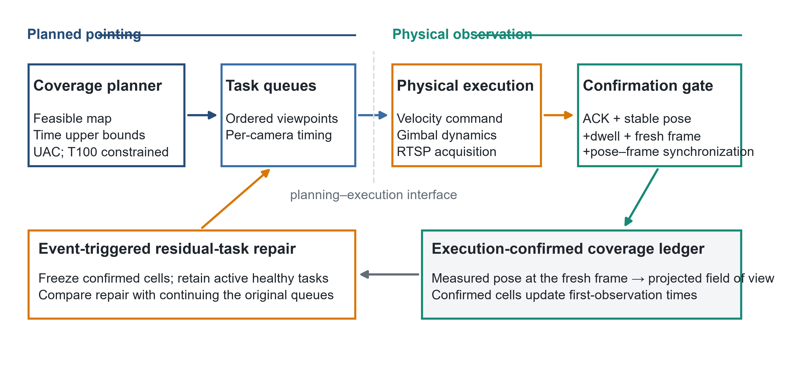
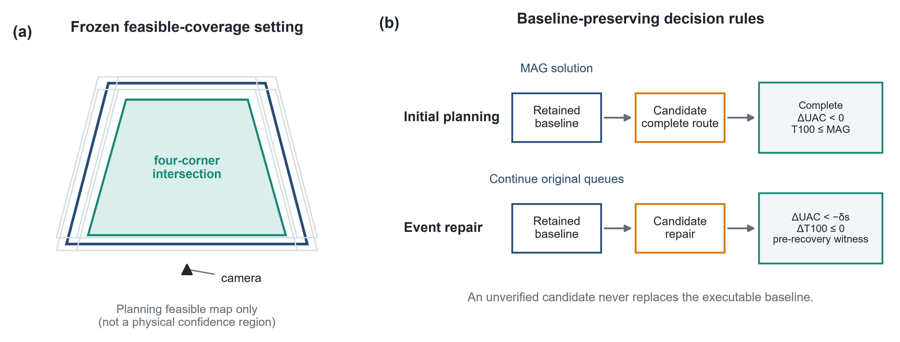
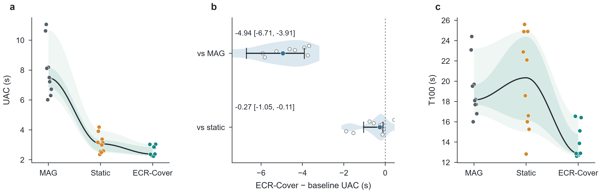
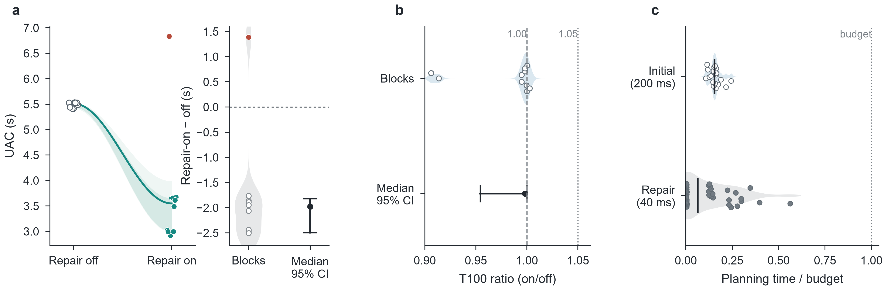

# 网络化定向相机系统中的执行确认协同覆盖与基线保持修复

**Execution-Confirmed Cooperative Coverage with Baseline-Preserving Repair in Networked Directional Camera Systems**

**匿名审阅稿**　作者、单位、通信作者、基金及数据仓库信息待作者确认。

**摘要—** 网络化定向相机可通过协同转向扩大团队视场，但计划视向并不能证明物理观测已经发生。设备转动与稳定、视频刷新、姿态—图像同步以及短时不可用都会改变空间单元的首次有效观测时间。本文提出执行确认协同覆盖方法 ECR-Cover，以固定时域内未覆盖曲线面积为主目标，并约束完整覆盖时间。初始规划保留运动感知贪心（MAG）方案作为可执行基线，只有在鲁棒目标下降且完整覆盖时间上界不增加时才接受局部修改。运行过程中，覆盖更新必须依次获得命令确认、稳定姿态、驻留、到位后新图像帧和实测姿态投影；事件修复也始终与继续原队列这一可执行方案比较。四台 ZR10 的实物实验使用 240 次分层转移校准执行时间，并按冻结协议完成 70 次运行。标称条件下，ECR-Cover 在不恶化 T100 的同时降低了相对两种基线的配对 UAC。修复消融中，10 个配对区组有 9 个改善，T100 满足预注册的 5% 非劣界，并且每次开启修复的运行都在原设备恢复前形成了由实测姿态和新帧支持的重分配覆盖。结果表明，将规划、物理执行、观测确认和事件修复置于同一闭环，可以在当前平台上降低区域首次观测延迟，并保持完工尾部。

**关键词—** 协同覆盖；主动视觉；网络化感知机器人；任务分配；执行确认

# 1　引言

区域覆盖是巡检、基础设施监测、环境感知和无可靠目标先验搜索中的基础任务。经典研究通常把环境表示为单元、节点或连续密度，并优化总路程、任务时间或感知代价 [1]–[4]。多机器人方法进一步利用并行运动与任务分配降低完工时间，近年来又引入局部搜索、在线按需分配、规划—执行并发以及面向优先区域的首次访问延迟 [5]–[9]。这些方法不断提高路线的响应性，但多数规划器仍将“按计划到达节点”视为“完成访问”。

这一抽象在网络化定向相机中并不稳固。相机通过改变光轴而不是移动基座覆盖空间，一个视向可以同时覆盖多个单元，其价值取决于视场几何、站址和重叠关系。更重要的是，建立一次观测所需的时间并不等于角程除以标称速度，还包括命令传输、云台闭环运动、稳定、驻留、视频刷新以及图像与姿态的关联。ACK 只能说明命令链路正常，不能说明相机已经到位；姿态满足容差时，RTSP 缓冲中仍可能是到位前的旧帧；反之，一帧新图像若缺少同步姿态，也不能支持空间覆盖判断。因此，物理观测事件位于计划视向和控制命令之后。

该差异会同时影响优化与评价。若按计划到达时刻更新覆盖，目标函数和覆盖曲线会建立在尚未发生的事件上。设备短时不可用时，重新生成一组队列也未必比健康设备继续执行原队列更好。修复只有在其预测收益超过切换代价和模型不确定性，并且随后能够形成可观测的重分配覆盖时才有意义。这些问题共同构成 planning–execution mismatch：规划器处理可行视向、单元关系和预测完成时间，硬件实际提供的却是命令、延迟姿态、图像帧和设备可用性事件。

主动相机网络已经研究了高速跟踪、目标切换、预测调度和倍率控制 [14]–[16]；鲁棒主动感知和韧性分配分别处理运动不确定性、感知质量、故障与时间约束 [20]–[22]。然而，这些研究并未直接给出一条从计划视向、实测姿态到到位后新帧的可审计覆盖证据链，也没有要求每次在线修复都在相同覆盖目标下优于“继续原队列”这一可执行基线。

本文面向固定三维区域的首次有效覆盖，将定向相机视为姿态可控的网络化感知机器人。主指标为固定时域内未覆盖比例的积分，即 UAC；T100 作为完工尾部约束，而不是与 UAC 混合成依赖权重的目标。只有在目标静止、初始位置在等权单元上均匀分布且首次有效观测必然检出的限定条件下，UAC 才可解释为截断期望发现延迟；在未知目标运动与未知检测概率下，本文只把它解释为截断首次观测延迟。

ECR-Cover 由三部分组成。初始规划以完整 MAG 路线为保底，并只接受保持完整覆盖、严格降低鲁棒 UAC 且不越过 MAG T100 上界的修改；执行阶段以“命令—连续稳定姿态—驻留—到位后新帧—姿态投影”确认覆盖；设备状态变化时，以已经确认的覆盖集合构造剩余问题，并把继续原队列作为修复基线。四项理论结论分别属于规划结构、日志—模型一致性、条件完整性和剩余计划的基线保持性质，不被扩大为物理几何保证或通用最优性定理。实物实验则独立检验这些结构性质是否转化为真实执行中的 UAC、T100、重分配见证与计算预算结果。

# 2　相关工作

## 2.1　协同与多机器人覆盖

覆盖规划包括连续覆盖控制、单元分解、图遍历、采样规划和启发式分配。连续方法根据空间密度布置移动传感器 [1]，传感器驱动方法可根据局部观测增量构造环境分解 [4]，综述工作系统总结了离线规划、完备性与路径代价 [2], [3]。多机器人场景进一步关注区域划分、路线交互与在线任务分配 [5], [6]。局部搜索方法从完整解出发，通过跨机器人交换或路线重构改善任务 [7]；在线按需覆盖与并发规划分别减少预先分配的不适应性和规划等待 [8], [9]。优先覆盖、视场感知巡逻、分布匹配布设和随机目标持续覆盖则把首次访问或传感器作用域引入目标 [10]–[13]。

ECR-Cover 与上述工作共享“完整基线＋局部改善”的组织方式，但研究边界不同。固定相机的视向是一项集合覆盖动作，而不是移动机器人对单一节点的访问。本文进一步把计划可行性与已经执行的观测分开：前者用于规划，后者只能由物理证据产生。

## 2.2　主动与网络化相机系统

云台相机研究已经实现了网络化跟踪、高帧率视觉反馈、预测调度和倍率控制 [14]–[16]，说明相机运动、图像时序与网络组织在真实系统中不可分离。多机器人三维重建和任务相关探索还通过协同视向获取互补场景信息 [17]–[19]。这些工作的核心目标通常是维持目标可见性、提高重建质量或获得语义信息，而不是确认每个空间单元的首次有效观测时刻。

本文采用更克制的观测定义：不推断目标身份、重建质量或检测概率。一个单元只有在到位后获得可用新帧，并且该帧可关联到同步实测姿态、由该姿态投影出的视场包含该单元时，才被计入覆盖。这一操作性定义把几何可行与物理确认区分开来，尤其适合控制与 RTSP 视频不共享完成信号的网络化相机。

## 2.3　执行不确定性与韧性分配

动态任务分配和韧性分配分别研究了不确定时间约束、异构能力和机器人故障 [21], [22]。大邻域搜索提供了从可行解出发、在搜索被中断时仍返回已验证 incumbent 的通用思想 [23]。ECR-Cover 使用较小的确定性邻域，但同样要求未验证候选不能替换可执行基线。

执行时间模型还与校准预测有关。共形预测在可交换性条件下给出有限样本边际覆盖解释，Mondrian 思想允许按预定义组分别校准 [24], [25]。本文按角程分组，避免大角度残差支配短转移；理论分析并不把未来数据自动视为可交换，而是明确以“实际执行时间不超过校准上界”为条件。这样可以把时间校准的经验有效性与确定性的基线保持逻辑分开。

# 3　问题定义

## 3.1　空间单元、候选视向与可行覆盖

设设备集合为 $\mathcal R=\{1,\ldots,N\}$，待覆盖区域由 $M$ 个等权单元中心组成，记为 $\mathcal C=\{\mathbf x_m\}_{m=1}^{M}$。设备 $i$ 的候选视向集合为 $\mathcal Q_i$，其中 $q=(\theta_{iq},\phi_{iq})$ 分别表示控制坐标中的方位角和俯仰角。给定设备位姿、安装旋转、相机内参与固定倍率，针孔模型确定名义覆盖集合 $\mathcal B_{iq}$。

规划器使用冻结的可行覆盖映射 $\mathcal B^{\mathrm a}_{iq}\subseteq\mathcal B_{iq}$。当前实现以控制完成容差构造该映射。令 $\mathcal D_i=[-e_i^\theta,e_i^\theta]\times[-e_i^\phi,e_i^\phi]$，其四角交集为

$$
\mathcal B^{\mathrm s}_{iq}=\bigcap_{(\delta_\theta,\delta_\phi)\in\operatorname{corners}(\mathcal D_i)}
\mathcal B_i(\theta_{iq}+\delta_\theta,\phi_{iq}+\delta_\phi),
\qquad \mathcal B^{\mathrm a}_{iq}=\mathcal B^{\mathrm s}_{iq}.\qquad \text{(1)}
$$

式 (1) 是冻结实现中的四角交集，只用于减小规划对名义视场边界单元的依赖。它不是包含站址、安装外参和逐机内参误差的物理置信域，也不是本文的主要创新。只要所有比较方法使用同一冻结映射，换用其他可行映射并不改变后续基线保持证明。设备 $i$ 的有序路线为 $\pi_i=(q_{i1},\ldots,q_{iK_i})$，团队方案记为 $\Pi=\{\pi_i\}_{i=1}^{N}$。若候选集合的并集不能覆盖 $\mathcal C$，任务在规划前判为不可行。

## 3.2　端到端执行时间上界

一次视向任务从首个相关控制命令开始，到连续稳定、驻留完成且获得到位后新帧为止。设备 $i$ 从 $q$ 转移到 $q'$ 的点预测为

$$
\hat\tau_i(q,q')=\beta_{i0}+\beta_{i\theta+}[\Delta\theta]_+
+\beta_{i\theta-}[-\Delta\theta]_+
+\beta_{i\phi+}[\Delta\phi]_+
+\beta_{i\phi-}[-\Delta\phi]_+
+\beta_{ic}\,\mathbb I_{2\mathrm a}.\qquad \text{(2)}
$$

其中 $[x]_+=\max(x,0)$，$\Delta\theta$ 和 $\Delta\phi$ 为包角后的两轴变化，$\mathbb I_{2\mathrm a}$ 表示双轴同时运动，系数均约束为非负并由 Huber 加权非负最小二乘拟合。令 $d=\max(|\Delta\theta|,|\Delta\phi|)$，将转移分为小角程（$d\le3^\circ$）、中角程（$3^\circ<d\le12^\circ$）和大角程（$d>12^\circ$），在与拟合集整段分离的校准运行上计算单侧残差分位数 $r_g$。规划上界为

$$
\bar\tau_i(q,q')=\max\{\tau_{\min},\hat\tau_i(q,q')+r_{g(q,q')}\}.\qquad \text{(3)}
$$

分组校准避免大角程残差决定所有短转移的余量。若未来转移与相应组的校准数据可交换，式 (3) 具有有限样本边际覆盖解释；后续命题只使用更明确的条件，即实际端到端时间不超过该上界。

## 3.3　首次有效覆盖目标

令 $a_{ik}$ 为设备 $i$ 完成第 $k$ 个视向的预测确认时刻。单元 $m$ 的规划首次覆盖上界为

$$
\bar T_m(\Pi)=\min_{i,k:\,m\in\mathcal B^{\mathrm a}_{iq_{ik}}}a_{ik}.\qquad \text{(4)}
$$

固定评价时域为 $H$，定义鲁棒未覆盖曲线面积

$$
\overline{\mathrm{UAC}}_H(\Pi)=\frac{1}{M}\sum_{m=1}^{M}\min\{\bar T_m(\Pi),H\}
=\int_0^H [1-\bar C(t)]\,\mathrm dt.\qquad \text{(5)}
$$

其中 $\bar C(t)=M^{-1}\sum_m\mathbb I[\bar T_m\le t]$。实际指标以执行确认时刻 $T_m$ 代替 $\bar T_m$。未在 $H$ 内确认的单元贡献完整时域，不会因运行提前结束而从统计中消失。另定义 $T_{95}$ 为 $\{T_m\}$ 的 95% 分位数，$T_{100}=\max_m T_m$。ECR-Cover 求解

$$
\min_{\Pi}\ \overline{\mathrm{UAC}}_H(\Pi),\quad
\text{s.t. }\bigcup_{i,q\in\pi_i}\mathcal B^{\mathrm a}_{iq}=\mathcal C,
\quad \bar T_{100}(\Pi)\le \bar T_{100}(\Pi_{\mathrm{MAG}}).\qquad \text{(6)}
$$

其中 $\Pi_{\mathrm{MAG}}$ 是相同可行映射与初始姿态下的完整 MAG 方案。T95、总角运动量和负载变异系数只用于确定性排序，不能覆盖 UAC 改善和 T100 约束。

{width=17.4cm}

# 4　ECR-Cover 方法

## 4.1　系统级规划—执行—观测闭环

ECR-Cover 同时维护计划状态与物理状态。计划状态包含候选视向、可行单元集、预测端到端时间和有序队列；物理状态包含设备可用性、命令结果、姿态样本、图像帧以及已经确认的单元。计划单元可以影响路线选择，只有确认单元能够改变实际覆盖曲线。设备状态变化时，剩余问题从确认集合而不是计划应完成集合出发；健康设备继续当前任务，规划器在固定预算内比较候选。搜索被中断时返回最近一次已经验证的 incumbent。

## 4.2　基线保持的初始规划

算法首先以边际可行覆盖增益与标称机动代价之比确定性地构造完整 MAG 路线，并以其作为可执行保底与固定 T100 上界。第二个完整种子使用式 (3) 的实测时间上界。随后按固定顺序搜索删除冗余视向、设备内重定位、视向替换或跨设备迁移三类邻域。每次接受后从第一类邻域重新开始；达到评估次数或 200 ms 墙钟预算时直接返回当前已验证方案。

设当前方案为 $\Pi$、候选为 $\Pi'$、数值容差为 $\varepsilon$。接受条件为

$$
\begin{aligned}
&\bigcup_{i,q\in\pi_i'}\mathcal B^{\mathrm a}_{iq}=\mathcal C,\\
&\overline{\mathrm{UAC}}_H(\Pi')<\overline{\mathrm{UAC}}_H(\Pi)-\varepsilon,\\
&\bar T_{100}(\Pi')\le\bar T_{100}(\Pi_{\mathrm{MAG}})+\varepsilon.\qquad \text{(7)}
\end{aligned}
$$

实现中还对未收缩名义视场的 T100 施加同一非增约束，防止安全核心的重叠关系删去对执行尾部有用的并行视向。

**命题 1（初始规划的基线保持性）**　若 $\Pi_{\mathrm{MAG}}$ 完整覆盖 $\mathcal C$，则任意规划预算终止时，ECR-Cover 返回完整方案 $\Pi^*$，且

$$
\overline{\mathrm{UAC}}_H(\Pi^*)\le\overline{\mathrm{UAC}}_H(\Pi_{\mathrm{MAG}}),\qquad
\bar T_{100}(\Pi^*)\le\bar T_{100}(\Pi_{\mathrm{MAG}}).\qquad \text{(8)}
$$

**证明：** 初始 incumbent 即完整的 $\Pi_{\mathrm{MAG}}$。式 (7) 保证每个被接受方案仍完整、鲁棒 UAC 严格下降且不越过固定 T100 上界；被拒绝候选不改变 incumbent，预算终止也不会提交未验证候选。结论对有限接受序列归纳成立。$\square$

该结论相对于共同可行覆盖映射和时间模型成立，不表示全局最优，也不推出每次真实运行的 UAC 都必然低于 MAG；后者由独立实物配对检验。

## 4.3　执行确认覆盖

每台设备依次执行 MOVE、SETTLE、DWELL、FRAME-CONFIRM 和 COMPLETE。MOVE 根据实测姿态闭环下发速度指令；ACK 不表示到位。姿态误差与角速度在稳定窗内持续满足门限后完成稳定与驻留；FRAME-CONFIRM 要求规定数量、在到位后产生且通过可用性、分辨率、亮度、对比度与清晰度门限的新帧，最终帧与姿态样本的主机时间差还需满足同步界。

令 $e_{ik}=1$ 表示任务通过完整证据链，$t^c_{ik}$ 为完成时刻，$\widehat{\mathcal B}_{ik}$ 为按确认帧关联实测姿态投影的单元集，则

$$
y_m(t)=\mathbb I\!\left[\exists(i,k):e_{ik}=1,\;m\in\widehat{\mathcal B}_{ik},\;t^c_{ik}\le t\right].\qquad \text{(9)}
$$

**命题 2（覆盖记录的模型内一致性）**　若式 (9) 在时刻 $t$ 将单元 $m$ 标记为覆盖，日志中必存在同一任务的成功命令结果、连续稳定姿态、到位后可用新帧以及满足同步界的实测姿态；在冻结投影模型内，$m$ 位于该姿态投影视场中。

**证明：** 覆盖记录只在 COMPLETE 入口写入，而状态机只有依次通过命令、稳定、驻留、帧质量、帧新鲜度和同步门才可进入 COMPLETE。写入集合由最终帧关联实测姿态计算，任一条件失败均不能产生覆盖记录。$\square$

**命题 3（条件完整性）**　若可行覆盖映射联合覆盖 $\mathcal C$，不可用设备在有限时间恢复，且每个下发的可达任务最终完成执行确认，则 ECR-Cover 在有限次有效完成后确认全部单元。

**证明：** 候选视向和单元均有限。每次有效完成要么新增未确认单元，要么耗尽一个因其他视向已覆盖而冗余的有限任务；修复不删除已确认覆盖。因此剩余集合单调不增，并在给定条件下有限终止。$\square$

## 4.4　事件触发的剩余任务修复

设备不可用时，算法冻结已经确认的覆盖，并保留健康设备正在执行的任务和原队列。设剩余单元为 $\mathcal U$，故障设备未完成任务中、没有被健康队列覆盖的单元构成可迁移集合 $\mathcal X\subseteq\mathcal U$。健康设备完成当前任务后的预测姿态和保守剩余时间成为新起点；继续原队列定义可执行基线 $\Pi^0$。

修复只向健康队列插入能够覆盖 $\mathcal X$ 的候选视向，最多接受三次插入并在 40 ms 内完成。候选 $\Pi^+$ 只有在

$$
\overline{\mathrm{UAC}}_H(\Pi^{+})
<\overline{\mathrm{UAC}}_H(\Pi^{0})-\delta_s,\qquad
\bar T_{100}(\Pi^{+})\le\bar T_{100}(\Pi^{0}).\qquad \text{(10)}
$$

且至少一个迁移单元的预测确认时刻早于原设备最早恢复时刻减去裕量 $\delta_w$ 时才提交。恢复事件采用相同基线比较，防止队列抖动。规划与健康设备当前执行并行，不因单台设备事件暂停整个团队。

**命题 4（事件修复的基线保持性）**　每次提交的修复相对 $\Pi^0$ 至少降低 $\delta_s$ 的预测剩余 UAC，不增加预测剩余 T100，并包含一个恢复前重分配覆盖见证。

**证明：** $\Pi^0$ 在搜索期间始终可执行，候选只有通过式 (10) 和恢复前见证检查后才替换它，结论直接由提交条件成立。该结论属于校准模型内的剩余计划，真实见证由执行日志独立检查。$\square$

## 4.5　形式性质的适用范围

命题 1 与命题 4 是冻结规划模型中的结构不变量；命题 2 是日志事件与冻结投影模型的一致性；命题 3 明确依赖可达性、恢复和最终确认条件。四者都不能单独证明相对基线的物理统计优越性，也不能证明绝对世界坐标中的视场精度。物理优越性需要冻结后的配对实物数据，几何精度则需要当前平台尚未提供的外部标定证据。

{width=17.4cm}

# 5　实验系统与方法

## 5.1　四相机平台与冻结几何

平台由四台 ZR10 云台相机构成，控制器以 10 Hz 运行，采用 `velocity_p` 模式并接收四路 RTSP。冻结局部模型中的相机坐标为 $(-5,-5,1.5)$、$(-5,5,1.5)$、$(5,5,1.5)$ 和 $(5,-5,1.5)$ m；评价区域为 $[112,128]\times[-8,8]\times[52,68]$ m，离散成 $8\times12\times4=384$ 个等权单元。倍率固定为 10 倍，配置分辨率为 $1920\times1080$，安全角域为方位 $[-35^\circ,35^\circ]$、俯仰 $[-20^\circ,20^\circ]$。这些坐标只定义内部一致的局部几何，不用于声明绝对指向精度。

## 5.2　执行确认阈值

稳定门要求两轴计划—实测误差不超过 $1^\circ$、角速度不超过 $0.8^\circ$/s，并连续满足 0.35 s；驻留为 0.8 s，至少取得 3 个新帧，帧—姿态时间差不超过 0.2 s，新帧等待不超过 2 s。48 次独立校准转移的方位误差中位数、95% 分位数和最大值为 $0.667^\circ$、$0.941^\circ$、$1.000^\circ$，俯仰对应为 $0.469^\circ$、$0.870^\circ$、$0.893^\circ$；48 次测试转移的两轴最大值为 $0.891^\circ$ 和 $0.889^\circ$。因此冻结设置取 $e_i^\theta=e_i^\phi=1^\circ$。

## 5.3　执行时间校准

每台设备执行 60 次分层转移，共 240 次。36 次完整运行样本用于拟合，12 次独立运行用于残差校准，另 12 次独立运行只用于测试，同一次运行的数据不跨集合。表 1 给出独立测试结果。

**表 1　端到端执行时间模型的独立测试结果**

| 设备 | 测试转移数 | MAE / s | RMSE / s | 上界覆盖率 | 平均上界余量 / s |
|:---:|---:|---:|---:|---:|---:|
| ZR10-1 | 12 | 3.262 | 3.719 | 100.0% | 5.917 |
| ZR10-2 | 12 | 3.977 | 4.655 | 91.7% | 5.917 |
| ZR10-3 | 12 | 4.458 | 5.367 | 83.3% | 6.098 |
| ZR10-4 | 12 | 5.229 | 7.469 | 83.3% | 6.823 |
| 合计/均值 | 48 | 4.231 | 5.302 | 89.6% | 6.188 |

为说明冻结可行映射的几何影响，在不增加实物实验的前提下，把容差半宽设为 $0^\circ$、$0.5^\circ$、$1.0^\circ$ 和 $1.5^\circ$，重新计算候选覆盖与初始方案。表 2 只描述规划敏感性，不比较不同容差的实物性能。

**表 2　冻结模型下规划可行映射的离线敏感性**

| 容差半宽 / deg | 单视向中位覆盖单元 | 中位保留率 | 规划任务数 | 规划 UAC / s | 规划 T100 / s |
|:---:|---:|---:|---:|---:|---:|
| 0.0 | 138 | 100.0% | 5 | 4.816 | 17.886 |
| 0.5 | 94 | 68.7% | 8 | 6.394 | 21.486 |
| 1.0 | 56 | 40.3% | 16 | 9.970 | 40.348 |
| 1.5 | 24 | 16.2% | 33 | 17.204 | 85.519 |

## 5.4　实验协议与研究问题

评价时域固定为 $H=60$ s，每次记录 85 s。运行前检查四台设备姿态、倍率、视频和配置哈希，运行后归零。统计单位是一整次实物运行，不把控制周期、帧、事件或单元作为独立样本。

标称实验采用 10 个随机化区组，每区组运行 ECR-Cover、MAG 和实测时间静态规划，共 30 次。扰动实验在确认覆盖率首次达到 50% 时，按冻结规则选择拥有最多独占剩余覆盖的活动设备并逻辑暂停 25 s。10 个区组比较 ECR-Cover 与实测静态规划；另 10 个区组固定相同初始路线、暂停规则和覆盖证据，配对比较修复开启与关闭。两项扰动协议与标称协议合计 70 次运行。

研究问题分别为：执行时间上界在独立转移上的表现；标称条件下 UAC 改善及 T100 尾部；开关消融中修复是否改变 UAC 并满足 T100 非劣；覆盖与重分配事件是否均可追溯到实测姿态和新帧，以及规划是否满足预算。

## 5.5　统计分析

所有连续结果以运行级中位数和四分位距表示，图中保留 10 个原始观察。配对效应采用区组内差值或比值；报告的 95% 置信区间来自冻结分析中的 100000 次区组 bootstrap。方向性主假设使用预注册单侧精确符号检验。标称条件的主要比较为 ECR-Cover 相对 MAG 的 UAC；修复的主要效应为 repair-on 减 repair-off UAC。T100 以配对比值检验 5% 非劣界。T95、总角运动量、负载 CV、帧等待和规划时间为次级描述量。若运行未在 $H$ 内完成，未确认单元按 $H$ 截断；本次 70 次运行没有选择性删除或替换。

# 6　结果

## 6.1　执行时间模型

48 次独立测试转移中有 43 次被式 (3) 覆盖，合计经验覆盖率为 89.6%，接近预设的 90% 单侧水平。逐设备覆盖率为 83.3%–100.0%，平均上界余量为 5.917–6.823 s，MAE 为 3.262–5.229 s。该结果说明机械角程不足以单独描述从命令到新帧的完整时间，但不能解释为对校准范围之外网络状态的无条件保证。

表 2 表明 $1^\circ$ 半宽会显著改变规划：单视向中位覆盖由名义映射的 138 个单元降为 56 个，任务数由 5 增至 16。因此它不是可以忽略的数值修正，但仍只是冻结可行映射的一种构造；没有不同半宽下的实物比较，不能据此判断哪一半宽的物理性能最好。

## 6.2　标称首次覆盖性能

70 次实物运行均完成 384/384 单元确认。表 3 汇总 30 次标称运行。ECR-Cover、MAG 和实测静态规划的 UAC 中位数分别为 2.380 s、7.480 s 和 3.070 s。ECR-Cover 相对 MAG 的配对 UAC 中位差为 $-4.941$ s，95% CI 为 $[-6.707,-3.910]$ s，10 个区组均改善，单侧精确符号检验 $p=0.0009766$。相对实测静态规划的配对中位差为 $-0.265$ s，95% CI 为 $[-1.046,-0.110]$ s。

**表 3　标称条件下的实物覆盖结果，中位数 [IQR]，10 次/方法**

| 方法 | UAC / s | T95 / s | T100 / s | 总角运动量 / deg | 负载 CV |
|:---|---:|---:|---:|---:|---:|
| MAG | 7.480 [6.852, 8.173] | 18.152 [17.704, 19.653] | 18.152 [17.704, 19.653] | 304.264 | 0.143 |
| 实测静态规划 | 3.070 [2.569, 3.330] | 12.653 [12.160, 12.903] | 20.340 [16.153, 24.399] | **290.140** | 0.474 |
| **ECR-Cover** | **2.380 [2.286, 2.851]** | 12.837 [12.722, 12.895] | **12.891 [12.819, 14.800]** | 301.169 | 0.577 |

ECR-Cover 与实测静态规划的 T95 接近，但 T100 中位数降低 6.066 s，95% CI 为 $[-10.620,-1.916]$ s。相对 MAG 的 T100 比值中位数为 0.723，95% CI 为 $[0.647,0.807]$，低于 1.05 非劣界。UAC 改善并非通过推迟最后单元获得。ECR-Cover 的负载 CV 高于 MAG，说明首次覆盖目标允许具有较大早期收益的设备承担更多前序任务；负载均衡只是次级量。

{width=17.4cm}

## 6.3　短时中断与修复消融

ECR-Cover 与实测静态规划的扰动比较中，两者 UAC 中位数为 3.907 s 和 5.617 s，配对差为 $-1.134$ s，但 95% CI 为 $[-3.581,1.134]$ s；T100 中位数为 37.866 s 和 37.302 s。该比较同时改变初始路线和修复行为，不能把差异唯一归因于修复。

开关消融固定相同初始方案。修复开启与关闭的 UAC 中位数为 3.549 s 和 5.510 s，配对中位差为 $-1.979$ s，95% CI 为 $[-2.496,-1.821]$ s。10 个区组中 9 个改善、1 个不利，全部纳入图 4(a)，单侧精确符号检验 $p=0.010742$。修复开启与关闭的 T100 中位数为 37.965 s 和 38.007 s；比值中位数为 0.998，95% CI 为 $[0.954,1.0001]$，低于 1.05 非劣界。

每次 repair-on 运行都提交一次有效修复，并在暂停设备恢复前确认至少一个重分配单元；repair-off 没有此类事件。这说明队列改变不仅存在于规划日志，还通过实测姿态与到位后新帧产生了可观察结果。

## 6.4　执行证据审计与计算预算

70 次运行共产生 461 次覆盖确认事件。计划姿态与确认姿态的两轴绝对误差中位数均为 $0.5^\circ$，95% 分位数均为 $0.9^\circ$，没有事件超过 $1^\circ$ 完成门。在冻结投影模型内，461 次规划可行单元集均包含于对应实测姿态视场，日志写入单元也全部属于实测投影。规划核心与实测姿态视场的中位单元数为 63 和 180。该结果验证软件证据与冻结模型的一致性，不构成外部世界坐标标定。

所有用于覆盖的图像帧都通过可用性与分辨率检查，并能与姿态、帧号、任务和 COMPLETE 事件联表。修复消融档案中出现 1 个原始不可用帧状态，但没有被任何覆盖事件引用。

20 次初始规划耗时 21.52–48.79 ms，中位数 30.75 ms，低于 200 ms 预算；40 次暂停/恢复规划耗时 0.10–22.48 ms，中位数 2.56 ms，低于 40 ms 预算。这些数据证明冻结 Windows/Python 平台中的观测预算合规，不是硬实时可调度性结论。

{width=17.4cm}

# 7　讨论

## 7.1　planning–execution gap 的意义

标称实验说明，围绕端到端确认时间构造的规划会改变完整首次覆盖轨迹，而不只是改变几何路线。MAG 提供了可执行基线和确定性规划上界，ECR-Cover 在 10 个标称区组中均取得更低 UAC，并缩短了 T100。相对实测静态规划较小但区间不跨零的差异表明，收益一部分来自执行时间模型，一部分来自基线保持的局部路线搜索；这一归因是配对数据的解释，不是命题 1 的直接推论。

修复开关消融更接近机制层比较，因为初始路线、暂停规则与确认链路相同。9 个改善与 1 个不利区组说明，模型内接受条件不能消除真实执行波动；保留不利结果正是不能用理论判据替代实物配对的原因。与此同时，10 个恢复前覆盖见证又说明汇总效应对应真实任务迁移，而非只改变队列文本。

UAC 揭示了完工时间看不到的差异。标称条件下 ECR-Cover 与实测静态规划的 T95 接近，但 UAC 和 T100 不同；修复消融的主要改善出现在 UAC 与 T95，而 T100 几乎不变。这与“把有用观测前移，但最后一个受中断任务未必改变”的设计一致。较高负载 CV 反映首次观测目标对资源分配的取舍，而不是事后为结果寻找解释。

## 7.2　理论、日志与统计证据的层级

第一层是规划结构。保留 MAG 与原队列使得任何时限下都有完整、已经评价的可执行方案，式 (7) 和式 (10) 给出各自模型内的基线关系。第二层是实现一致性。状态机与日志保证覆盖写入具有命题 2 所需字段，461 次事件审计表明冻结实现遵循了该规则；70 次运行全部完成也说明命题 3 的条件在当前部署中成立。第三层是运行级实物统计。标称配对检验模型改善能否穿过硬件与网络时序，修复配对检验事件机制是否改变实际覆盖轨迹。三层互相补充，但不能相互替代。

四角规划核心同样需要按此分层理解。离线敏感性说明 $1^\circ$ 收缩会显著改变候选集合与任务数，因此不是鸡肋；但它仍只是一种共同可行映射。基线保持性质可在其他共同映射上成立，而绝对几何精度需要额外的外部标定。把它表述为控制坐标中的规划裕量，既保留真实工程影响，也避免把它扩大为物理置信域或主要创新。

## 7.3　局限性

本研究有八项明确边界。第一，覆盖在单一冻结局部几何中评价，站址、安装旋转与逐机内参没有使用外部目标真值验证。第二，$1^\circ$ 四角交集来自姿态完成门与遥测误差，未联合量化全部视场误差。第三，平台没有目标轨迹和检测真值，UAC 只表示首次空间观测机会；其期望发现延迟解释依赖静止、均匀和必然检出假设。第四，时间余量依赖分层校准数据的代表性，89.6% 测试覆盖不保证非平稳拥塞或不同视频参数下仍成立。

第五，部署只有四台相机和一个站点，不能支持更大网络、异构设备或不同重叠几何的结论。第六，正式任务为分钟级，未检验长期热漂移、编码器偏差、设备重启与多日网络变化。第七，不可用性通过可控逻辑暂停实现，尚未覆盖机械损坏、遥测错误、部分视频退化或永久失联。第八，规划集中运行于软实时 Windows/Python 平台；预算合规不等于硬实时保证，也不说明大网络中的通信竞争与分布式一致性。

# 8　结论

ECR-Cover 处理了网络化定向相机协同感知中的一个具体断点：计划视向不能证明物理观测已经发生。该方法把首次覆盖目标与端到端执行时间相连，在初始搜索和事件修复中保留可执行基线，并只用稳定实测姿态关联的新图像帧更新实际覆盖。

四台 ZR10 的冻结实验把不同形式性质对应到独立观测后果：初始规划保持 MAG 模型基线并在标称实物数据中降低 UAC 与 T100；执行日志完整记录 461 次覆盖事件；repair-on/off 配对显示首次覆盖延迟降低、T100 非劣，并在每次开启修复的运行中形成恢复前重分配见证。结论严格限定于当前几何、任务时长与网络规模，不扩展为目标检测概率或跨部署泛化结论。

核心设计原则是：规划、物理执行与观测证据应保持区分，直到可验证事件把它们连接起来。由此，路线改善可以始终相对于可执行替代方案受约束，覆盖性能也可以从传感器实际获得的证据中重建。

# 声明

**致谢：** [待去匿名后补充。]

**作者贡献：** [待去匿名后补充。]

**基金：** [基金来源与项目编号待作者确认。]

**利益冲突：** [待全体作者确认并填写。]

**数据可得性：** [仓库地址、开放时间和访问条件待填写。拟公开内容包括覆盖规划代码、冻结配置、运行级数据、分析脚本与可复现绘图代码，最终以作者的仓库审计为准。]

**生成式 AI 使用披露：** [待作者确认。正式表述应列明用于语言编辑或稿件形成的生成式 AI 工具，说明所有技术内容和引用均经人工核验，并声明作者对全文承担责任。]

**ToC 文本（55 词英文版见 Overleaf 工程）：** 计划视向不等于已经发生物理观测。ECR-Cover 把首次覆盖规划、命令执行、稳定实测姿态、新帧证据与基线保持修复连接为闭环。四相机实验表明，该方法降低首次观测延迟而不牺牲完整覆盖时间，并使每个覆盖更新都能追溯到同步的姿态—图像证据。

# 参考文献

[1] J. Cortés, S. Martínez, T. Karatas, and F. Bullo, “Coverage control for mobile sensing networks,” *IEEE Transactions on Robotics and Automation*, 20(2):243–255, 2004.

[2] E. Galceran and M. Carreras, “A survey on coverage path planning for robotics,” *Robotics and Autonomous Systems*, 61(12):1258–1276, 2013.

[3] C. S. Tan, R. Mohd-Mokhtar, and M. R. Arshad, “A comprehensive review of coverage path planning in robotics using classical and heuristic algorithms,” *IEEE Access*, 9:119310–119342, 2021.

[4] E. U. Acar and H. Choset, “Sensor-based coverage of unknown environments: Incremental construction of Morse decompositions,” *The International Journal of Robotics Research*, 21(4):345–366, 2002.

[5] Z. Wang et al., “APF-CPP: An artificial potential field based multi-robot online coverage path planning approach,” *IEEE Robotics and Automation Letters*, 9(11):9199–9206, 2024.

[6] Z. Wang et al., “MAC-Planner: A novel task allocation and path planning framework for multi-robot online coverage processes,” *IEEE Robotics and Automation Letters*, 10(5):4404–4411, 2025.

[7] J. Tang and H. Ma, “Large-scale multi-robot coverage path planning via local search,” *Proceedings of the AAAI Conference on Artificial Intelligence*, 38(16):17567–17574, 2024.

[8] R. Mitra and I. Saha, “Online on-demand multi-robot coverage path planning,” *IEEE ICRA*, 14583–14589, 2024.

[9] R. Mitra and I. Saha, “Online concurrent multi-robot coverage path planning,” *IEEE/RSJ IROS*, 8691–8698, 2025.

[10] K. Lee, H. Kim, J. Li, and J. Park, “Priority-aware multi-robot coverage path planning,” *IEEE Robotics and Automation Letters*, 11(3):3534–3541, 2026.

[11] B. Zuo et al., “FoM: Field-of-view-aware graph neural learning for min–max multi-robot patrol path planning,” *IEEE Robotics and Automation Letters*, 11(10):12080–12087, 2026.

[12] D. Ghimire and I. Saha, “Stein coverage: A variational inference approach to distribution-matching multisensor deployment,” *IEEE Robotics and Automation Letters*, 9(6):5370–5376, 2024.

[13] Z. Li et al., “Multi-vehicle cooperative persistent coverage for random target search,” *IEEE Robotics and Automation Letters*, 10(7):6680–6687, 2025.

[14] J. E et al., “WiseCam: A systematic approach to intelligent pan-tilt cameras for moving object tracking,” *IEEE Transactions on Mobile Computing*, 23(12):12330–12344, 2024.

[15] M. Jiang et al., “A 500-fps pan-tilt tracking system with deep-learning-based object detection,” *IEEE Robotics and Automation Letters*, 6(2):691–698, 2021.

[16] Y. Zhang et al., “A real-time automation framework for multi-target capture in large scenes with predictive scheduling and zoom control,” *IEEE Transactions on Automation Science and Engineering*, 23:250–264, 2026.

[17] G. Hardouin et al., “A multirobot system for 3-D surface reconstruction with centralized and distributed architectures,” *IEEE Transactions on Robotics*, 39(4):2623–2638, 2023.

[18] J. Zeng et al., “Multi-robot autonomous 3D reconstruction using Gaussian splatting with semantic guidance,” *IEEE Robotics and Automation Letters*, 10(6):5617–5624, 2025.

[19] K. Nagami et al., “VISTA: Open-vocabulary, task-relevant robot exploration with online semantic Gaussian splatting,” *IEEE Robotics and Automation Letters*, 11(3):3150–3157, 2026.

[20] M. Xanthidis et al., “ResiVis: A holistic underwater motion planning approach for robust active perception under uncertainties,” *IEEE Robotics and Automation Letters*, 9(11):9391–9398, 2024.

[21] S. Choudhury et al., “Dynamic multi-robot task allocation under uncertainty and temporal constraints,” *Autonomous Robots*, 46:231–247, 2022.

[22] G. Notomista et al., “A resilient and energy-aware task allocation framework for heterogeneous multirobot systems,” *IEEE Transactions on Robotics*, 38(1):159–179, 2022.

[23] S. Ropke and D. Pisinger, “An adaptive large neighborhood search heuristic for the pickup and delivery problem with time windows,” *Transportation Science*, 40(4):455–472, 2006.

[24] A. N. Angelopoulos and S. Bates, “Conformal prediction: A gentle introduction,” *Foundations and Trends in Machine Learning*, 16(4):494–591, 2023.

[25] H. Boström, U. Johansson, and T. Löfström, “Mondrian conformal predictive distributions,” *Proceedings of Machine Learning Research*, 152:24–38, 2021.

[26] W. Jing, D. Deng, Y. Wu, and K. Shimada, “Multi-UAV coverage path planning for the inspection of large and complex structures,” *IEEE/RSJ IROS*, 1480–1486, 2020.
