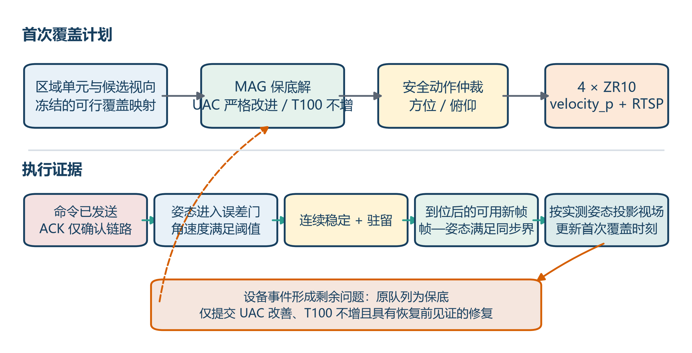
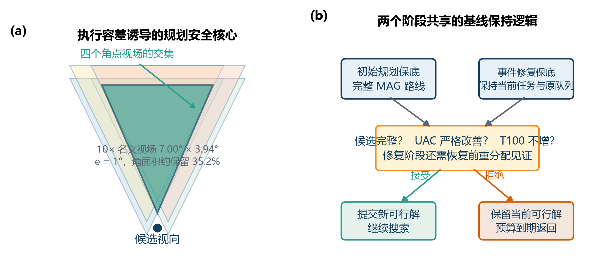
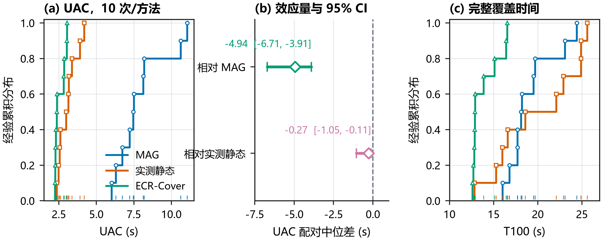
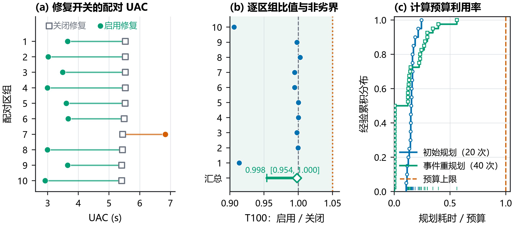

# 执行确认与非退化修复驱动的网络化定向相机协同覆盖

**Execution-Confirmed Cooperative Coverage with Non-Degrading Repair for Networked Directional Cameras**

**摘要—** 网络化定向视觉传感器可通过协同转向扩大瞬时视场，但规划视向并不等同于已经获得观测：设备转动、稳定、视频刷新以及短时不可用都会改变单元的首次有效覆盖时间。本文提出执行确认协同覆盖方法 ECR-Cover。该方法以固定时域内未覆盖曲线面积（uncovered-area criterion, UAC）为主目标，并以按角程分组校准的端到端执行时间上界递推首次覆盖时刻。初始规划保留完整的运动感知贪心（MAG）解作为保底，通过确定性局部搜索仅接受 UAC 严格下降且完整覆盖时间不增加的方案；运行中则由“命令—到位稳定—到位后新帧—实测姿态投影”证据链确认覆盖，并以原队列延续方案为保底实施事件触发修复。由此可证明，在共同的可行覆盖映射和执行时间上界下，规划结果的 UAC 与完整覆盖时间不劣于 MAG，在线修复相对原队列延续方案也具有同类非退化性。四台 ZR10 上的 240 次分层实测转移用于建立执行时间模型，随后按冻结协议完成 70 次实物运行。标称条件下，ECR-Cover 相对 MAG 的配对 UAC 中位差为 $-4.941$ s（95% bootstrap CI $[-6.707,-3.910]$ s），且完整覆盖时间比值的置信区间上界为 $0.807$。暂停消融中，启用修复相对关闭修复的 UAC 中位差为 $-1.979$ s（95% CI $[-2.496,-1.821]$ s，单侧精确符号检验 $p=0.0107$），T100 满足 5% 非劣界；10 次修复均在原设备恢复前形成了由实测姿态和新图像帧支持的重分配覆盖。结果表明，将覆盖目标、执行时间和观测证据置于同一闭环，可在不牺牲完工尾部的条件下降低区域首次观测延迟。

**关键词—** 多机器人覆盖；主动视觉；网络化机器人；任务分配；执行确认

# I. 引言

区域覆盖是环境巡检、基础设施监测和无先验目标搜索的共同基础。经典覆盖路径规划将机器人轨迹或传感器作用域映射为待访问单元，并主要优化总路程或任务完工时间 [1]–[3]。近年来，多机器人方法开始通过局部搜索 [4]、在线按需分配 [5]、规划与执行并发 [6] 以及优先区域的首次访问延迟 [7] 提升大规模覆盖效率。与移动机器人不同，网络化云台相机通过改变视轴而非平台位置覆盖空间；一个视向可同时覆盖多个单元，机动代价具有明显的设备、方向与角程依赖性，观测是否成立还取决于姿态稳定和图像刷新。

现有多机器人覆盖研究通常将“到达节点”视为已访问 [4]–[9]，主动相机网络则更多关注目标跟踪、切换或高分辨率成像 [10]–[12]。这两类研究在真实网络化传感器上留下了一个关键断点：计划中的视向或控制指令不能证明相机已经在该视向产生有效观测。若直接按标称时间更新覆盖，通信延迟、控制误差和视频陈旧会同时污染目标函数与实验指标；发生设备暂停后，重新生成一组队列也未必优于继续执行原队列。任务分配中的不确定性与韧性研究 [13], [14] 提供了事件驱动重分配框架，但并未给出与视场覆盖证据相一致的非退化判据。

本文把网络化定向相机视为一组姿态可控的感知机器人，研究固定三维区域的首次有效覆盖。评价不只考察最后一个单元何时完成，还显式度量所有单元的首次覆盖时刻。为避免用启发式权重掩盖长尾，UAC 是唯一主目标，T100 作为硬约束。所提 ECR-Cover 包含三个相互闭合的组成部分：

1. **基线保持的首次覆盖规划。** 以完整 MAG 路线为保底，以校准后的端到端执行时间上界评价 UAC；所有局部修改都必须保持完整覆盖、严格降低 UAC 且不增加 MAG 的 T100 上界。该非退化性对共同使用的任意冻结可行覆盖映射成立。
2. **基于实测姿态与新帧的覆盖确认。** 执行阶段只有在 ACK、连续稳定、驻留及到位后新图像帧均成立时，才按该帧附近的实测姿态投影视场并更新覆盖。规划所用安全核心不直接产生覆盖记录。
3. **具有保底方案的事件修复。** 故障后保留健康设备正在执行的任务，以原队列延续方案为基线，只迁移故障设备独占的未完成覆盖；修复必须带来超过切换阈值的剩余 UAC 改善、保持 T100 不增，并预测在原设备恢复前产生重分配覆盖。

本文给出模型内覆盖记录一致性、条件完整性、初始规划非退化性和事件修复非退化性四项结论，并通过四台真实云台相机验证各结论的可观测后果。实验不依赖目标真值，研究对象严格限定为配置几何模型下的首次有效区域覆盖。

# II. 问题定义

## A. 区域、视场与执行路线

设设备集合为 $\mathcal R=\{1,\ldots,N\}$，待覆盖区域由 $M$ 个等权单元中心组成，记为 $\mathcal C=\{\mathbf x_m\}_{m=1}^{M}$。设备 $i$ 的候选视向集合为 $\mathcal Q_i$，其中 $q=(\theta_{iq},\phi_{iq})$ 分别表示方位角和俯仰角。给定设备位姿、安装旋转、相机内参和固定倍率，针孔模型确定候选视向的名义覆盖集合 $\mathcal B_{iq}$。规划器接收一个冻结的可行覆盖映射 $\mathcal B^{\mathrm a}_{iq}\subseteq\mathcal B_{iq}$；该映射只参与路线构造和目标计算，实际覆盖仍由执行阶段的实测姿态确定。

本实验以执行完成容差构造 $\mathcal B^{\mathrm a}_{iq}$。令 $\mathcal D_i=[-e_i^\theta,e_i^\theta]\times[-e_i^\phi,e_i^\phi]$，其中 $e_i^\theta$ 和 $e_i^\phi$ 分别为方位与俯仰的容差半宽，$\operatorname{corners}(\mathcal D_i)$ 表示误差盒的四个角点。规划安全核心定义为

$$
\mathcal B^{\mathrm s}_{iq}=\bigcap_{(\delta_\theta,\delta_\phi)\in\operatorname{corners}(\mathcal D_i)}
\mathcal B_i(\theta_{iq}+\delta_\theta,\phi_{iq}+\delta_\phi),
\qquad \mathcal B^{\mathrm a}_{iq}=\mathcal B^{\mathrm s}_{iq}.\qquad \text{(1)}
$$

式 (1) 是当前冻结实现采用的四角交集安全核心，而不是对站址、安装外参和逐机内参全部误差的物理置信域。其作用是避免规划依赖名义视场边缘；理论结果只要求所有比较方法使用同一 $\mathcal B^{\mathrm a}_{iq}$，不依赖该映射的具体构造。每台设备的路线 $\pi_i=(q_{i1},\ldots,q_{iK_i})$ 是候选视向的有序序列，团队方案记为 $\Pi=\{\pi_i\}_{i=1}^{N}$。若全部可行覆盖集合的并集不能覆盖 $\mathcal C$，任务在规划前即判为不可行。

## B. 端到端执行时间上界

一次任务的执行时间从首个相关控制指令发出开始，到姿态连续稳定、驻留结束且取得到位后的新图像帧为止。对设备 $i$，从视向 $q$ 转移至 $q'$ 的点预测采用非负单调模型

$$
\hat\tau_i(q,q')=\beta_{i0}+\beta_{i\theta+}[\Delta\theta]_+
+\beta_{i\theta-}[-\Delta\theta]_+
+\beta_{i\phi+}[\Delta\phi]_+
+\beta_{i\phi-}[-\Delta\phi]_+
+\beta_{ic}\,\mathbb I_{2\mathrm a}.\qquad \text{(2)}
$$

其中 $[x]_+=\max(x,0)$，$\Delta\theta$ 和 $\Delta\phi$ 是包角后的方位变化与俯仰变化，$\mathbb I_{2\mathrm a}$ 表示双轴同时运动，所有系数均非负。系数由 Huber 加权非负最小二乘拟合。按 $d=\max(|\Delta\theta|,|\Delta\phi|)$ 将转移分为小角程（$d\le3^\circ$）、中角程（$3^\circ<d\le12^\circ$）与大角程（$d>12^\circ$），并在与拟合集整段分离的校准运行上计算单侧残差分位数 $r_g$ [15], [16]。规划上界为

$$
\bar\tau_i(q,q')=\max\{\tau_{\min},\hat\tau_i(q,q')+r_{g(q,q')}\}.\qquad \text{(3)}
$$

分组校准避免大角程残差支配短距离转移。若未来转移与校准样本在对应组内可交换，式 (3) 具有有限样本的边际覆盖解释；后续理论只使用“实际执行时间不超过式 (3)”这一明确条件。

## C. 首次覆盖目标

令 $a_{ik}$ 为设备 $i$ 完成路线中第 $k$ 个视向的预测时刻，由式 (3) 逐项递推。单元 $m$ 的规划首次覆盖上界为

$$
\bar T_m(\Pi)=\min_{i,k:\,m\in\mathcal B^{\mathrm a}_{iq_{ik}}}a_{ik}.\qquad \text{(4)}
$$

固定评价时域为 $H$，定义未覆盖曲线面积

$$
\overline{\mathrm{UAC}}_H(\Pi)=\frac{1}{M}\sum_{m=1}^{M}\min\{\bar T_m(\Pi),H\}
=\int_0^H [1-\bar C(t)]\,\mathrm dt.\qquad \text{(5)}
$$

其中 $\bar C(t)=M^{-1}\sum_m\mathbb I[\bar T_m\le t]$。实际指标 $\mathrm{UAC}_H$ 用执行确认得到的 $T_m$ 代替 $\bar T_m$。若目标初始位置在等权单元上均匀分布、目标在任务期间静止且首次有效观测必然检出，则 $\mathrm{UAC}_H=\mathbb E[\min(T,H)]$；在未知运动和未知检测概率下，它仅表示截断的首次观测延迟。

另定义 $T_{95}$ 为 $\{T_m\}$ 的 95% 分位数，$T_{100}=\max_m T_m$。ECR-Cover 求解

$$
\min_{\Pi}\ \overline{\mathrm{UAC}}_H(\Pi),\quad
\text{s.t. }\bigcup_{i,q\in\pi_i}\mathcal B^{\mathrm a}_{iq}=\mathcal C,
\quad \bar T_{100}(\Pi)\le \bar T_{100}(\Pi_{\mathrm{MAG}}).\qquad \text{(6)}
$$

其中 $\Pi_{\mathrm{MAG}}$ 为在相同可行覆盖映射和初始姿态下构造的完整 MAG 路线。T95、总角运动量和设备负载变异系数只用于确定性候选排序，不改变式 (6) 的主目标与尾部约束。

{width=16.8cm}

# III. ECR-Cover 方法

## A. 基线保持的初始规划

算法首先用边际可行覆盖增益与标称机动代价之比，确定性地追加候选视向，直到得到完整的 $\Pi_{\mathrm{MAG}}$。该路线同时作为保底解和 T100 上界。第二个种子使用式 (3) 的实测时间上界构造完整静态路线。此后在固定评估次数与 200 ms 墙钟预算内依次搜索三类邻域：删除冗余视向、设备内重定位，以及视向替换或跨设备迁移。每次接受后从第一类邻域重新开始；到达预算时直接返回当前可行解。

设当前解为 $\Pi$、候选解为 $\Pi'$、数值容差为 $\varepsilon$。候选仅在以下条件同时成立时被接受：

$$
\begin{aligned}
&\bigcup_{i,q\in\pi_i'}\mathcal B^{\mathrm a}_{iq}=\mathcal C,\\
&\overline{\mathrm{UAC}}_H(\Pi')<\overline{\mathrm{UAC}}_H(\Pi)-\varepsilon,\\
&\bar T_{100}(\Pi')\le\bar T_{100}(\Pi_{\mathrm{MAG}})+\varepsilon.\qquad \text{(7)}
\end{aligned}
$$

实际实现还对名义视场下的 T100 施加同一非增约束，避免安全核心的重叠关系删去对执行尾部有用的并行视向。

**命题 1（初始规划非退化性）：** 若 $\Pi_{\mathrm{MAG}}$ 完整覆盖 $\mathcal C$，则 ECR-Cover 在任意规划预算终止时返回完整方案 $\Pi^*$，且

$$
\overline{\mathrm{UAC}}_H(\Pi^*)\le\overline{\mathrm{UAC}}_H(\Pi_{\mathrm{MAG}}),\qquad
\bar T_{100}(\Pi^*)\le\bar T_{100}(\Pi_{\mathrm{MAG}}).\qquad \text{(8)}
$$

**证明：** 初始保底解即为完整的 $\Pi_{\mathrm{MAG}}$。式 (7) 保证每个被接受的解仍完整、UAC 严格下降且 T100 不越过固定上界；被拒绝的候选不改变当前可行解。预算终止只中断搜索，不替换已验证解。因此上述不变量对有限次接受归纳成立。$\square$

这一构造与利用局部邻域改善完整覆盖解的思路 [4] 一致，但式 (7) 把启发式搜索的可行基线直接转化为可审计的不劣保证，并把首次覆盖延迟置于完工时间之前 [7]。

## B. 执行确认覆盖

每台设备按 MOVE、SETTLE、DWELL、FRAME-CONFIRM 和 COMPLETE 五个阶段执行视向。MOVE 阶段依据实时姿态闭环下发速度指令；ACK 仅证明命令链路正常。姿态误差和角速度在连续稳定窗内满足阈值后进入 SETTLE，随后完成规定驻留。FRAME-CONFIRM 要求获得规定数量、在驻留开始后产生且通过分辨率、亮度、对比度和清晰度门限的新帧。最终确认帧的主机侧采集时刻与姿态样本时刻之差不得超过同步界。

令 $e_{ik}=1$ 表示第 $k$ 个任务完成上述证据链，$t^c_{ik}$ 为完成时刻，$\widehat{\mathcal B}_{ik}$ 为按确认帧附近的实测姿态重新投影所得视场。实际覆盖状态为

$$
y_m(t)=\mathbb I\!\left[\exists(i,k):e_{ik}=1,\;m\in\widehat{\mathcal B}_{ik},\;t^c_{ik}\le t\right].\qquad \text{(9)}
$$

**命题 2（模型内覆盖记录一致性）：** 若单元 $m$ 在时刻 $t$ 被式 (9) 标记为覆盖，则日志中必存在同一任务的成功命令结果、连续稳定姿态、到位后可用新帧以及与该帧满足同步界的实测姿态，且在冻结投影模型下，$m$ 位于该姿态投影的视场内。

**证明：** 覆盖集合只在 COMPLETE 入口更新；进入 COMPLETE 必须依次通过命令、稳定、驻留和新帧门。更新操作使用最终帧关联的实测姿态计算 $\widehat{\mathcal B}_{ik}$，并只写入其成员。任一前置条件不满足时状态机不能执行该写入。$\square$

**命题 3（条件完整性）：** 若可行覆盖映射的联合覆盖为 $\mathcal C$，设备在有限时间后恢复可用，且每个被下发的可达任务最终完成执行确认，则 ECR-Cover 在有限次有效任务完成后覆盖全部单元。

**证明：** 候选和单元集合均有限。每次有效完成要么新增至少一个未覆盖单元，要么结束一个因其他视向已覆盖而冗余的有限任务。修复不删除已确认覆盖。故剩余未覆盖集合单调缩小，并在给定条件下有限终止。$\square$

{width=16.8cm}

## C. 事件触发的剩余任务修复

设备短时不可用时，算法冻结已确认覆盖，并保留健康设备当前正在执行的任务及其原队列。设剩余单元集合为 $\mathcal U$，故障设备原队列中、未被其他设备队列覆盖的单元组成可迁移集合 $\mathcal X\subseteq\mathcal U$。健康设备完成当前任务后的姿态和保守剩余执行时间作为新队列起点；继续执行原队列得到保底方案 $\Pi^{0}$。

修复只向健康设备队列插入可覆盖 $\mathcal X$ 的候选视向，最多接受三次插入，并在 40 ms 内完成。设候选方案为 $\Pi^{+}$，切换阈值为 $\delta_s$。仅当

$$
\overline{\mathrm{UAC}}_H(\Pi^{+})
<\overline{\mathrm{UAC}}_H(\Pi^{0})-\delta_s,\qquad
\bar T_{100}(\Pi^{+})\le\bar T_{100}(\Pi^{0}).\qquad \text{(10)}
$$

且至少一个被迁移单元的预测确认时刻早于原设备最早恢复时刻减去裕量 $\delta_w$ 时，才提交修复；否则继续执行 $\Pi^0$。恢复事件采用相同判据，避免队列抖动。规划与未故障设备的当前执行并行，因此单台设备事件不会让团队整体停顿 [6]。

**命题 4（事件修复非退化性）：** 每次被提交的修复相对 $\Pi^0$ 使预测剩余 UAC 至少降低 $\delta_s$，不增加预测剩余 T100，并包含一个恢复前重分配覆盖见证。

**证明：** $\Pi^0$ 始终保留为可执行保底解；候选只有通过式 (10) 和恢复前见证检验后才替换它。故结论直接由提交条件成立。该结论针对校准上界下的剩余计划；实际收益由执行确认事件独立检验。$\square$

# IV. 实物实验

## A. 平台、时间模型与实验协议

平台由四台 ZR10 云台相机构成，控制器以 10 Hz 运行，采用 `velocity_p` 模式并接收四路 RTSP。四台设备位于局部模型坐标 $(-5,-5,1.5)$、$(-5,5,1.5)$、$(5,5,1.5)$ 和 $(5,-5,1.5)$ m；评价区域为 $[112,128]\times[-8,8]\times[52,68]$ m，并均匀离散为 $8\times12\times4$ 个单元。固定 10 倍倍率，配置分辨率为 $1920\times1080$；安全角域为方位 $[-35^\circ,35^\circ]$、俯仰 $[-20^\circ,20^\circ]$。这些坐标定义的是同一冻结局部几何模型，不用于声明绝对世界坐标指向精度。

执行确认阈值为：计划姿态与实测姿态之差不超过 $1^\circ$，角速度不超过 $0.8^\circ$/s，连续稳定 $0.35$ s，驻留 $0.8$ s，至少 3 个新帧，帧—姿态时间差不超过 $0.2$ s，新帧等待不超过 2 s。48 次独立校准转移的方位到位误差中位数、95% 分位数和最大值分别为 $0.667^\circ$、$0.941^\circ$ 和 $1.000^\circ$，俯仰对应为 $0.469^\circ$、$0.870^\circ$ 和 $0.893^\circ$；48 次独立测试转移的两轴最大值分别为 $0.891^\circ$ 和 $0.889^\circ$。据此，式 (1) 对两轴均取 $e_i^\theta=e_i^\phi=1^\circ$。该数值是控制与遥测坐标中的执行完成容差，不包含未独立验证的站址、安装外参和逐机内参误差。

时间模型使用每台设备 60 次、共 240 次转移。对每台设备，36 次完整运行样本用于拟合，12 次独立运行样本用于校准，12 次独立运行样本只用于测试；同一次运行的数据不跨集合。表 I 给出测试集结果。48 个测试转移中有 43 个被式 (3) 覆盖，合计经验覆盖率为 89.6%，接近设定的 90% 单侧水平。不同设备的 MAE 为 3.26–5.23 s，说明使用统一标称速度不足以描述端到端执行时间。

**表 I  端到端执行时间模型的独立测试结果**

| 设备 | 测试数 | MAE / s | RMSE / s | 上界覆盖率 | 平均上界余量 / s |
|:---:|---:|---:|---:|---:|---:|
| ZR10-1 | 12 | 3.262 | 3.719 | 100.0% | 5.917 |
| ZR10-2 | 12 | 3.977 | 4.655 | 91.7% | 5.917 |
| ZR10-3 | 12 | 4.458 | 5.367 | 83.3% | 6.098 |
| ZR10-4 | 12 | 5.229 | 7.469 | 83.3% | 6.823 |
| 合计/均值 | 48 | 4.231 | 5.302 | 89.6% | 6.188 |

实验采用 $H=60$ s 的固定评价时域，每次采集 85 s。所有运行均在开始前检查四台设备的姿态、倍率、视频和配置哈希，结束后执行归零。统计单位是一整次实物运行，不把控制周期或单元视为独立样本。配对区组内运行顺序预先随机化；报告中位数和四分位距（IQR），主要效应采用 100000 次区组 bootstrap 置信区间，并按预注册方向使用精确符号检验。

标称实验包含 10 个区组，每区组分别运行 ECR-Cover、MAG 和按式 (3) 构造但执行中不改队列的实测静态规划，共 30 次。扰动实验在覆盖率首次达到 50% 时，选择拥有最多独占剩余覆盖的活动设备逻辑暂停 25 s。第一组扰动实验在 10 个区组中比较 ECR-Cover 与实测静态规划；第二组采用相同初始规划、暂停规则与覆盖证据，对修复开启/关闭进行 10 组配对消融。两项冻结协议合计 70 次运行。全部比较方法使用相同的 $\mathcal B^{\mathrm a}_{iq}$，因此方法间效应不归因于安全核心的取值。

为量化该设置而不改变实物结论，在冻结几何与时间模型上将容差半宽依次设为 $0^\circ$、$0.5^\circ$、$1.0^\circ$ 和 $1.5^\circ$，重新计算候选覆盖及 V2.4.3 初始方案。表 II 表明，$1^\circ$ 安全核心并非微小边缘修正：单视向中位覆盖由 138 个单元降至 56 个，规划任务数由 5 增至 16。该分析只描述规划敏感性，不作为不同容差配置的实物性能比较。

**表 II  冻结模型下规划安全核心的离线敏感性**

| 容差半宽 / deg | 单视向中位覆盖单元 | 中位保留率 | 规划任务数 | 规划 UAC / s | 规划 T100 / s |
|:---:|---:|---:|---:|---:|---:|
| 0.0 | 138 | 100.0% | 5 | 4.816 | 17.886 |
| 0.5 | 94 | 68.7% | 8 | 6.394 | 21.486 |
| 1.0 | 56 | 40.3% | 16 | 9.970 | 40.348 |
| 1.5 | 24 | 16.2% | 33 | 17.204 | 85.519 |

最终 70 次运行共产生 461 次覆盖确认事件。计划姿态与确认姿态的方位、俯仰误差中位数均为 $0.5^\circ$，95% 分位数均为 $0.9^\circ$，没有事件超出 $1^\circ$ 完成门。在冻结投影模型下，461 次规划安全核心均包含于对应实测姿态视场，日志写入单元也全部属于该次实测投影；安全核心与实测视场的中位单元数分别为 63 和 180。上述结果验证了实现与冻结模型的一致性，同时说明该设置较为保守，不构成绝对世界坐标下的视场精度证明。

## B. 标称条件：首次覆盖效率与完工尾部

70 次运行均完成 384/384 单元覆盖。表 III 汇总标称实验。ECR-Cover 的 UAC 中位数为 2.380 s，MAG 为 7.480 s，实测静态规划为 3.070 s。相对 MAG，配对 UAC 中位差为 $-4.941$ s，95% CI 为 $[-6.707,-3.910]$ s，10 个区组均为负，单侧精确符号检验 $p=0.0009766$。相对实测静态规划，中位差为 $-0.265$ s，95% CI 为 $[-1.046,-0.110]$ s。ECR-Cover 与实测静态规划的 T95 接近，但前者 T100 中位数降低 6.066 s（95% CI $[-10.620,-1.916]$ s），说明 UAC 改善并非通过牺牲尾部获得。

**表 III  标称条件下的实物覆盖结果，中位数 [IQR]，10 次/方法**

| 方法 | UAC / s | T95 / s | T100 / s | 总角运动量 / deg | 负载 CV |
|:---|---:|---:|---:|---:|---:|
| MAG | 7.480 [6.852, 8.173] | 18.152 [17.704, 19.653] | 18.152 [17.704, 19.653] | 304.264 | 0.143 |
| 实测静态规划 | 3.070 [2.569, 3.330] | 12.653 [12.160, 12.903] | 20.340 [16.153, 24.399] | **290.140** | 0.474 |
| **ECR-Cover** | **2.380 [2.286, 2.851]** | 12.837 [12.722, 12.895] | **12.891 [12.819, 14.800]** | 301.169 | 0.577 |

ECR-Cover/MAG 的配对 T100 比值中位数为 0.723，95% CI 为 $[0.647,0.807]$，低于 1.05 的非劣界。总角运动量与 MAG 的配对差置信区间跨越零；负载 CV 高于 MAG，表明主目标更倾向于让能更早产生大覆盖增益的设备承担前序任务。该取舍与式 (6) 一致：负载均衡是次级量，不能覆盖 UAC 和 T100 的判据。

{width=16.8cm}

## C. 暂停条件：修复是否产生可观测收益

在 ECR-Cover 与实测静态规划的扰动比较中，两者 UAC 中位数分别为 3.907 s 和 5.617 s，配对差为 $-1.134$ s，但 95% CI 为 $[-3.581,1.134]$ s；T100 中位数分别为 37.866 s 和 37.302 s。该对照同时改变初始路线与修复机制，运行级样本不足以把差异唯一归因于修复，因此对修复作用采用初始计划相同的开关消融作主要判断。

在修复消融中，修复开启与关闭条件的 UAC 中位数分别为 3.549 s 和 5.510 s；配对中位差为 $-1.979$ s，95% CI 为 $[-2.496,-1.821]$ s。10 个区组中 9 个改善、1 个不利，全部原样纳入分析，单侧精确符号检验 $p=0.010742$。修复开启条件的 T95 中位数由 38.001 s 降至 20.206 s；T100 分别为 37.965 s 和 38.007 s。T100 比值中位数为 0.998，95% CI 为 $[0.954,1.0001]$，低于 1.05 非劣界。

每次修复开启运行均提交一次有效修复，并在原设备恢复前形成至少一个重分配覆盖确认；修复关闭运行没有此类事件。该覆盖事件都带有实测姿态和到位后新帧，因而同时验证了命题 4 的提交判据及其在真实设备执行链路中的结果。20 次初始规划耗时为 21.52–48.79 ms，中位数 30.75 ms；40 次暂停/恢复重规划耗时为 0.10–22.48 ms，中位数 2.56 ms，分别低于 200 ms 和 40 ms 预算。平台为软实时 Windows/Python 系统，这些数值表示冻结实验中的观测预算合规性。

{width=16.8cm}

# V. 结果与理论的对应关系

命题 1 是规划器在共同可行覆盖映射上的结构不变量。实物日志进一步保存了每次初始 MAG 目标、最终目标和接受操作，全部正式运行均通过完整性、UAC 不增和 T100 不增的逐次复算。标称配对结果说明这种规划层非退化在真实执行中转化为相对 MAG 的显著 UAC 改善和更短 T100。该统计优越性不是命题 1 的直接推论，而是对时间模型、执行闭环和硬件共同作用的独立验证。

命题 2 对应覆盖证据链。全部用于覆盖更新的图像帧均通过可用性与分辨率检查，并能与同一任务的姿态样本、帧号和完成事件联表；覆盖曲线因此由执行事件而非计划时刻产生。461 次确认事件中，规划安全核心与实测姿态投影在冻结模型内均满足包含关系，且没有日志写入单元落在对应实测视场之外。命题 3 的前提在本实验区域内成立：可行覆盖映射覆盖全部 384 个单元，所有暂停设备均在有限时间恢复，70 次运行均实现完全覆盖。

命题 4 只保证被接受修复的预测目标不劣于保底方案，实际效应仍需配对实验。修复开启与关闭条件共享初始路线和故障规则，UAC 置信区间完全低于零，T100 比值满足非劣界，且每次修复都有恢复前重分配覆盖，因而分别支撑平均首次覆盖改善、完工尾部不恶化和任务迁移在真实设备执行链路中生效三项判断。

本研究仍有明确边界。首先，覆盖基于冻结的局部几何与相机模型；站址、安装外参和逐机内参未以外部目标真值独立验证，因此 $1^\circ$ 安全核心只表示控制与遥测坐标中的规划裕量，不能解释为绝对世界坐标下的物理置信域，也不能把 UAC 直接解释为真实目标检测概率。其次，时间上界依赖分组内可交换性，测试集 89.6% 的经验覆盖与设定水平相符，但不构成对非平稳网络故障的无条件保证。最后，实验规模为单一四设备部署和分钟级任务，跨站点几何误差、长期漂移及更大网络中的通信竞争需要后续验证。

# VI. 结论

本文提出 ECR-Cover，将首次覆盖规划、执行证据和事件修复统一到网络化定向相机的闭环中。在共同的可行覆盖映射和执行时间上界下，MAG 保底解与严格接受规则给出了 UAC 和 T100 的确定性非退化保证；实测姿态与到位后新帧使覆盖状态可审计；以原队列为保底的修复只提交具有预测收益和恢复前见证的任务迁移。四台 ZR10 的冻结实物实验表明，所提方法在标称条件下显著降低相对 MAG 和实测静态规划的 UAC，并在暂停条件下通过配对消融证明在线修复降低首次覆盖延迟而不恶化 T100。当前 $1^\circ$ 规划安全核心是冻结实验中的具体可行覆盖设置，不承担独立创新或绝对指向精度结论。该框架可进一步扩展到移动传感机器人与异构主动视觉节点，只需为其提供一致的可行覆盖映射、端到端执行时间和观测确认接口。

# 参考文献

[1] E. Galceran and M. Carreras, “A survey on coverage path planning for robotics,” *Robotics and Autonomous Systems*, vol. 61, no. 12, pp. 1258–1276, 2013.

[2] J. Cortés, S. Martínez, T. Karatas, and F. Bullo, “Coverage control for mobile sensing networks,” *IEEE Transactions on Robotics and Automation*, vol. 20, no. 2, pp. 243–255, 2004.

[3] C. S. Tan, R. Mohd-Mokhtar, and M. R. Arshad, “A comprehensive review of coverage path planning in robotics using classical and heuristic algorithms,” *IEEE Access*, vol. 9, pp. 119310–119342, 2021.

[4] J. Tang and H. Ma, “Large-scale multi-robot coverage path planning via local search,” in *Proc. AAAI Conf. Artificial Intelligence*, vol. 38, no. 16, pp. 17567–17574, 2024.

[5] R. Mitra and I. Saha, “Online on-demand multi-robot coverage path planning,” in *Proc. IEEE Int. Conf. Robotics and Automation (ICRA)*, pp. 14583–14589, 2024.

[6] R. Mitra and I. Saha, “Online concurrent multi-robot coverage path planning,” in *Proc. IEEE/RSJ Int. Conf. Intelligent Robots and Systems (IROS)*, pp. 8691–8698, 2025.

[7] K. Lee, H. Kim, J. Li, and J. Park, “Priority-aware multi-robot coverage path planning,” *IEEE Robotics and Automation Letters*, vol. 11, no. 3, pp. 3534–3541, 2026.

[8] Z. Wang *et al*., “APF-CPP: An artificial potential field based multi-robot online coverage path planning approach,” *IEEE Robotics and Automation Letters*, vol. 9, no. 11, pp. 9199–9206, 2024.

[9] Z. Wang *et al*., “MAC-Planner: A novel task allocation and path planning framework for multi-robot online coverage processes,” *IEEE Robotics and Automation Letters*, vol. 10, no. 5, pp. 4404–4411, 2025.

[10] J. E *et al*., “WiseCam: A systematic approach to intelligent pan-tilt cameras for moving object tracking,” *IEEE Transactions on Mobile Computing*, vol. 23, no. 12, pp. 12330–12344, 2024.

[11] M. Jiang, K. Shimasaki, S. Hu, T. Senoo, and I. Ishii, “A 500-fps pan-tilt tracking system with deep-learning-based object detection,” *IEEE Robotics and Automation Letters*, vol. 6, no. 2, pp. 691–698, 2021.

[12] Y. Zhang *et al*., “A real-time automation framework for multi-target capture in large scenes with predictive scheduling and zoom control,” *IEEE Transactions on Automation Science and Engineering*, vol. 23, pp. 250–264, 2026.

[13] S. Choudhury, J. K. Gupta, M. J. Kochenderfer, D. Sadigh, and J. Bohg, “Dynamic multi-robot task allocation under uncertainty and temporal constraints,” *Autonomous Robots*, vol. 46, pp. 231–247, 2022.

[14] G. Notomista *et al*., “A resilient and energy-aware task allocation framework for heterogeneous multirobot systems,” *IEEE Transactions on Robotics*, vol. 38, no. 1, pp. 159–179, 2022.

[15] A. N. Angelopoulos and S. Bates, “Conformal prediction: A gentle introduction,” *Foundations and Trends in Machine Learning*, vol. 16, no. 4, pp. 494–591, 2023.

[16] H. Boström, U. Johansson, and T. Löfström, “Mondrian conformal predictive distributions,” in *Proc. 10th Symp. Conformal and Probabilistic Prediction and Applications*, PMLR, vol. 152, pp. 24–38, 2021.

[17] M. Xanthidis *et al*., “ResiVis: A holistic underwater motion planning approach for robust active perception under uncertainties,” *IEEE Robotics and Automation Letters*, vol. 9, no. 11, pp. 9391–9398, 2024.

[18] G. Hardouin, J. Moras, F. Morbidi, J. Marzat, and E. M. Mouaddib, “A multirobot system for 3-D surface reconstruction with centralized and distributed architectures,” *IEEE Transactions on Robotics*, vol. 39, no. 4, pp. 2623–2638, 2023.
