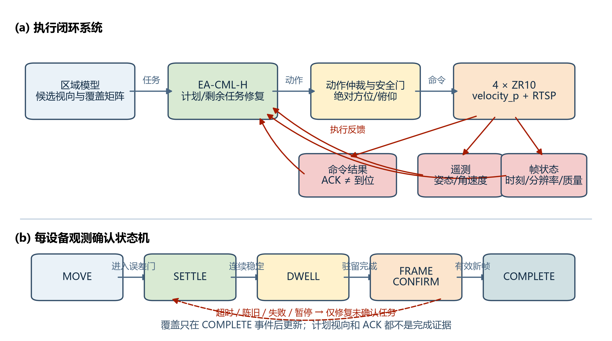
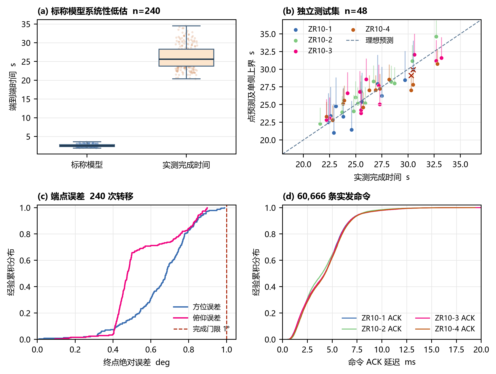
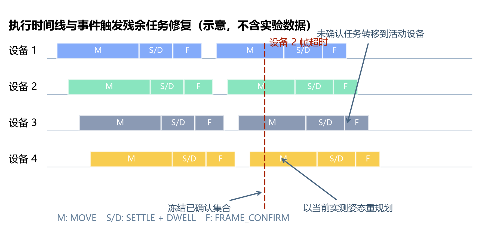
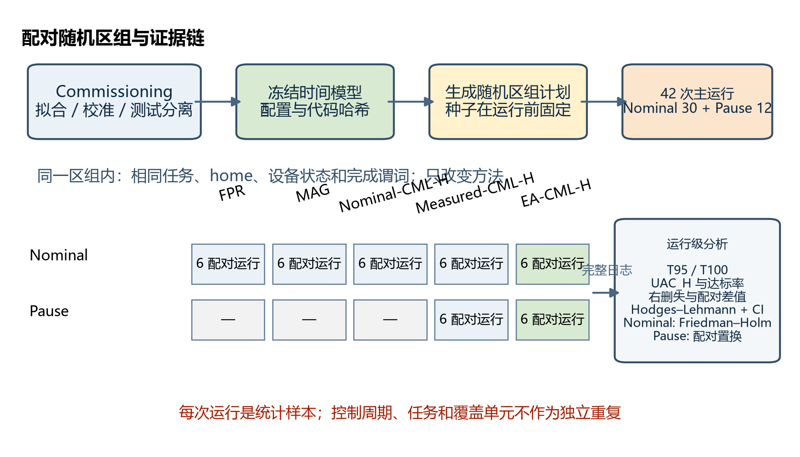

# 网络化云台相机的执行确认协同视场覆盖

**Execution-Confirmed Cooperative Field-of-View Coverage for Networked Pan–Tilt Cameras**

匿名稿（中文技术稿）

## 摘要

网络化方向传感器的协同扫描既是覆盖规划问题，也是执行判定问题。按标称转速生成的计划无法直接说明云台是否到位、图像是否稳定，更不能证明某个视场已经形成有效观测。本文研究无目标先验条件下的执行确认协同视场覆盖。搜索区域被离散为候选视向覆盖的配置模型单元；只有实时姿态持续满足位置与角速度门限、驻留结束，并收到稳定后产生的时序有效新帧时，任务才提交覆盖事件。在此基础上，本文提出执行感知覆盖—机动—负载启发式 EA-CML-H：利用独立转移数据拟合设备相关完成时间，以单侧 split-conformal 校准构造规划上界，以边际覆盖、团队瓶颈和执行不确定性评价插入，并在遥测、命令、帧或设备状态异常时只修复未确认任务。四台 ZR10 上的 240 次实物转移表明，标称模型对全部样本均低估完成时间，平均预测为 2.61 s，而实测平均值为 26.23 s，MAE 为 23.61 s。设备相关模型在预先划分的 48 个独立测试样本上取得 1.16 s 的汇总 MAE 和 1.42 s 的 RMSE，单侧上界覆盖 46/48 个样本。全部转移均满足 1° 终点误差门；60,666 条实发命令全部收到 ACK，143,927 帧中 143,923 帧通过质量门。结果说明，执行完成不能由计划时刻替代，所提出的证书与时间模型可在真实网络化云台链路上工作。覆盖方法之间的运行级比较采用冻结的配对区组协议另行完成，不由本轮标定数据推断。

**关键词：** 多机器人系统；主动视觉；云台相机；协同覆盖；执行反馈；任务分配

## 1 引言

方向可控相机把有限视场变成了可调度的感知资源。固定站点云台、搭载云台的机器人和分布式主动视觉节点都需要决定：由哪台设备、以什么方向、在何时形成一次有效观测。在没有目标位置或先验概率图时，这一任务首先表现为视场覆盖。困难不只在于选取和排序视向，还在于规划器所使用的“完成”必须与物理执行一致。命令已经发出、计划时刻已经到达或云台瞬时进入角度门，都不能替代稳定后的新图像。

覆盖控制与覆盖路径规划已经形成了从 Voronoi 部署到多机器人路径分解的研究脉络 [1]–[3]。近期在线方法根据执行进度重新分配区域或路径：APF-CPP 在未知动态环境中更新个体策略 [4]；MAC-Planner 联合在线任务分配和覆盖路径规划 [5]；On-Demand 与 Concurrent MCPP 分别在机器人完成已有路径时按需规划，或让规划与执行并发 [6], [7]；PA-MCPP 进一步区分优先区域的覆盖时延和最终完工时间 [8]。这些工作主要以机器人到达栅格或路径终点作为覆盖事件。对于通过转动、稳定和成像完成观测的网络化云台，这一事件还缺少图像层证据。

感知视场进入规划后，问题也不再等同于访问所有位置。Stein Coverage 针对异构各向异性传感器优化分布匹配部署 [9]，FoM 把可选视向纳入 min–max 多机器人巡逻 [10]，面向随机目标的持续覆盖方法则显式建立目标生成和探测模型 [11]。后者反映了一个关键边界：若没有目标运动与探测模型，几何覆盖时间不能直接解释为真实目标发现时间。

PTZ 主动视觉研究从另一侧说明了执行链的重要性。WiseCam 将目标运动与机械转动成本共同纳入单相机跟踪 [12]；高速视觉云台通过高频图像反馈降低检测时延 [13]；多目标捕获框架把 PTZ 调整时间和控制时延纳入调度 [14]。这些方法由已检测目标或轨迹驱动，不处理无目标条件下多台相机的有限区域覆盖。不确定任务分配 [15]、异构机器人能力失效后的重分配 [16] 和不确定环境中的主动感知规划 [17] 提供了持续时间与能力变化下的规划工具，但没有给出多 PTZ 覆盖任务由物理观测完成的统一判据。单侧 split-conformal 校准可以把独立校准残差转换为有限样本边际上界 [18]，适合把实测执行误差引入调度代价。

同一执行语义也适用于更广泛的网络化机器人感知。开放词汇主动探索 [20]、多机器人语义三维重建 [21]、集中与分布式表面重建 [22] 以及多无人机结构巡检 [23] 都需要在有限时间内选择观测资源。它们的任务目标不同，但计划中的一次观测都必须落到可验证的传感器事件上。本文处理的不是语义理解或重建本身，而是计划层与物理观测层之间的接口。

本文关注计划与观测之间的缺口：在线覆盖利用“完成”状态，PTZ 主动视觉重视转动和成像时延，不确定任务分配根据能力变化重排任务；但多台网络化 PTZ 的有限区域覆盖、由有效图像支持的完成认证，以及异常后的残余任务修复仍缺少统一处理。原有 CML-ALNS 离线方法把视场、标称运动和并行负载放进同一调度模型，却在计划时刻到达时计入覆盖，无法反映 `velocity_p` 控制、稳定保持和网络视频的联合时延。本文让执行证据直接决定覆盖状态与后续调度。

本文的贡献为：

1. 提出**由传感器证据驱动的覆盖定义**。遥测新鲜度、姿态误差、角速度、连续稳定、驻留和稳定后的有效新帧共同构成完成证书；据此定义执行确认的 \(T_{95}\)、\(T_{100}\) 和平均首次覆盖时间。
2. 提出**EA-CML-H 调度方法**。设备相关完成时间由独立转移数据学习，单侧 split-conformal 残差给出规划上界；覆盖收益、团队瓶颈与执行不确定性进入同一插入评分，异常时只重排未确认任务。
3. 构建**四台 ZR10 的可复现实物证据链**。240 次转移被预先划分为拟合、校准和测试集，完整记录命令 ACK、姿态、帧状态与完成事件。实测结果量化了标称时间模型的系统偏差，并验证了完成证书和设备相关模型。
4. 冻结**面向覆盖方法比较的配对区组协议**。五种方法共享几何模型、完成门和安全约束；运行级指标与异常处理规则事先确定，使后续主比较能够区分时间建模、执行确认与在线修复的作用。

## 2 问题定义

### 2.1 网络化方向传感器与模型覆盖

考虑 \(N\) 台固定安装的方向可控相机，设备集合为 \(\mathcal I=\{1,\ldots,N\}\)。设备 \(i\) 的位置和安装旋转分别为 \(\mathbf p_i\) 与 \(\mathbf R_i\)，本地方位、俯仰限位为 \(\Theta_i\) 和 \(\Phi_i\)。搜索区域的配置包络框被等距采样为 \(M\) 个等权模型单元中心

\[
\mathcal C=\{\mathbf x_m\in\mathbb R^3\mid m=1,\ldots,M\}.
\qquad\text{(1)}
\]

主实验冻结的评估网格为 \(8\times12\times4\)，即 \(M=384\)；它只是在共同配置模型上比较方法的离散化，不是已标定的三维体积真值。视向与指标使用这一网格事前生成并冻结；实验后只使用同一事件日志在 \(6\times10\times4\) 和 \(10\times15\times5\) 网格上做离散密度敏感性诊断，不据此重新选择算法参数。

候选视向 \(q\in\mathcal Q_i\) 用本地绝对角 \(\mathbf q_{iq}=(\theta_{iq},\phi_{iq})\) 表示。空间点先经安装旋转与云台逆解映射到本地角度，避免把世界坐标中的方位直接当作设备命令。固定倍率 \(z^\star\) 下，设备 \(i\) 的水平和垂直视场由图像尺寸 \((W_i,H_i)\) 与插值内参 \((f_{x,i},f_{y,i})\) 给出：

\[
\alpha_i^h=2\arctan\frac{W_i}{2f_{x,i}(z^\star)},\qquad
\alpha_i^v=2\arctan\frac{H_i}{2f_{y,i}(z^\star)}.
\qquad\text{(2)}
\]

令 \((\theta_{im},\phi_{im})\) 为单元 \(m\) 在设备局部坐标下的方向，\(\chi_{im}\) 表示机械视域、软件安全角域与静态遮挡共同给出的可达门。采用半视场保守裕度 \(\mu\)，覆盖矩阵为

\[
A_{iqm}=\chi_{im}\,
\mathbf 1\!\left(|\operatorname{wrap}(\theta_{im}-\theta_{iq})|
\le \frac{(1-\mu)\alpha_i^h}{2}\right)
\mathbf 1\!\left(|\phi_{im}-\phi_{iq}|
\le \frac{(1-\mu)\alpha_i^v}{2}\right).
\qquad\text{(3)}
\]

式（3）只根据配置几何模型与角域判断样本点是否被视向覆盖，未建模距离相关成像质量、动态遮挡或目标探测率，因而不等同于真实场景中经外部测量验证的绝对可见面积或体积。若某个单元对所有活动设备都不可达，系统在任务开始前报告不可行，而不是改变覆盖分母。

### 2.2 观测完成证书

每个视向任务不是一个命令，而是一个具有物理证据的状态转换。修复可能使同一视向重试或转移到另一设备，因此以 \(a\) 表示唯一执行尝试。设备 \(i\) 对任务 \(q\) 的第 \(a\) 次完成证书记为

\[
\mathcal E_{iqa}=\bigl(
t^{cmd}_{iqa},t^{in}_{iqa},t^{set}_{iqa},t^{dw}_{iqa},t^{frm}_{iqa},
\delta^\theta_{iqa},\delta^\phi_{iqa},v_{iqa},f_{iqa},s_{iqa}
\bigr),
\qquad\text{(4)}
\]

其中五个时刻分别表示首次命令、进入误差门、连续稳定、驻留结束与有效帧确认；\(\delta^\theta,\delta^\phi\) 是稳定窗口内最大姿态误差，\(v\) 是最大角速度，\(f\) 是帧证据摘要，\(s\) 是命令与健康状态。仅当下列谓词全部为真时，\(e_{iqa}=1\)：

\[
\begin{aligned}
e_{iqa}={}&\mathbf 1[\text{telemetry fresh and connected}]\\
&\land\mathbf 1[|\delta^\theta_{iqa}|\le\epsilon_\theta,
|\delta^\phi_{iqa}|\le\epsilon_\phi]\\
&\land\mathbf 1[|\dot\theta_i|\le\epsilon_{\dot\theta},
|\dot\phi_i|\le\epsilon_{\dot\phi}
\text{ for }w_s]\\
&\land\mathbf 1[\text{dwell}\ge w_d]
\land\mathbf 1[\text{new usable frames}\ge n_f]\\
&\land\mathbf 1[\text{no explicit command failure}].
\end{aligned}
\qquad\text{(5)}
\]

ACK 只表明命令链路得到响应，不进入姿态到位条件。有效帧必须在驻留开始后产生，帧标识递增，年龄不超过门限，解码成功且分辨率与所用内参一致。亮度、对比度和清晰度门只有在现场分布被记录后才启用；帧门不执行目标检测。

尝试的确认完成时刻为 \(t^c_{iqa}=t^{frm}_{iqa}\)。单元首次覆盖时刻与累计覆盖率为

\[
t_m=\min_{i,q,a:A_{iqm}=1,\ e_{iqa}=1} t^c_{iqa},
\qquad\text{(6)}
\]

\[
C^{exec}(t)=\frac{1}{M}\sum_{m=1}^{M}\mathbf 1(t_m\le t).
\qquad\text{(7)}
\]

尚未确认的单元令 \(t_m=+\infty\)。主指标为

\[
T_\rho^{exec}=\inf\{t:C^{exec}(t)\ge\rho\},\quad
\bar T_{first}=\frac{1}{M}\sum_{m=1}^{M}t_m.
\qquad\text{(8)}
\]

成功完成时，\(\bar T_{first}\) 也等于 \([0,T_{100}^{exec}]\) 上未覆盖曲线 \(1-C^{exec}(t)\) 的积分。本文用 \(T_{95}^{exec}\) 描述尾部覆盖效率，用 \(T_{100}^{exec}\) 描述完全覆盖长尾。只有在目标静止、对等权单元均匀分布且首次有效观测必然检出的特殊模型下，式（7）才是首次发现时间的分布函数；本文没有真实目标与检测真值，因而不把式（8）解释为实测目标发现时间。

### 2.3 优化目标

在给定任务可行且所有方法使用相同完成谓词的前提下，计划目标按字典序排列：

\[
\min_{\mathcal S}
\left(
T_{95}^{pred},\ \bar T_{first}^{pred},\ T_{100}^{pred},\
\sum_i L_i^{pred},\ R(\mathcal S)
\right)_{lex},
\qquad\text{(9)}
\]

其中 \(L_i^{pred}\) 是设备 \(i\) 的预测完成时间。令 \(n_m(\mathcal S)=\sum_i\sum_{q\in S_i}A_{iqm}\)，重复覆盖系数定义为 \(R(\mathcal S)=M^{-1}\sum_m[n_m(\mathcal S)-1]_+\)。主实验仍完整报告所有指标；字典序规定方法的设计优先级，但后文的有界插入评分只是其可审计启发式代理，不声称求得字典序全局最优解。

## 3 EA-CML-H 方法

### 3.1 独立标定与完成时间上界

标称最大速度无法代表 `velocity_p` 控制下的转动—稳定—图像可用时间。本文在主比较前，为每台设备执行独立设备标定试验（commissioning）。令 \(\Delta\theta=\theta'-\theta\)、\(\Delta\phi=\phi'-\phi\)，单次转移的特征为

\[
\mathbf z=\bigl[1,
[\Delta\theta]_+,[-\Delta\theta]_+,
[\Delta\phi]_+,[-\Delta\phi]_+\bigr]^T,
\qquad\text{(10)}
\]

响应量从首次新目标命令计到式（5）的帧确认，已包含 MOVE、SETTLE、DWELL 与新鲜帧等待。样本在执行前按设备、方向和角程分层为拟合集 \(\mathcal D_i^{fit}\)、校准集 \(\mathcal D_i^{cal}\) 与测试集 \(\mathcal D_i^{test}\)。拟合集使用 Huber 迭代重加权最小二乘（IRLS）；每个加权子问题用非负最小二乘求解，截距和四个方向斜率均非负，\(\ell_2\) 稳定项仅作用于斜率。得到的设备相关点预测为 \(\hat\tau_i(\mathbf z)\)。校准残差为

\[
r_j=\Delta t_j-\hat\tau_i(\mathbf z_j),\qquad j\in\mathcal D_i^{cal}.
\qquad\text{(11)}
\]

风险水平 \(\alpha\) 预先设为 0.1，令 \(n_i^{cal}=|\mathcal D_i^{cal}|\)，并要求 \(\alpha\ge 1/(n_i^{cal}+1)\)。排序位置为

\[
k_i=\left\lceil(n_i^{cal}+1)(1-\alpha)\right\rceil\le n_i^{cal}.
\qquad\text{(12)}
\]

若该条件不满足，有限样本分位上界应视为 \(+\infty\)；实验工具直接拒绝拟合，要求增加校准样本或事前改变 \(\alpha\)，不会把排序位置静默截断为 \(n_i^{cal}\)。

设备相关保守完成时间为

\[
\widetilde\tau_i(q,q')=
\max\{\tau_{min},\hat\tau_i(\mathbf z_{qq'})+r_{i,(k_i)}\}.
\qquad\text{(13)}
\]

在校准样本与未来转移可交换时，式（13）具有单侧 split-conformal 的有限样本边际覆盖解释 [18]。该结论不覆盖热漂移、持续掉线或未见过的控制故障。因此，独立测试集还需报告 MAE、RMSE、低估率、经验覆盖率与上界宽度；若测试分布明显漂移，停止主实验并重做设备标定，而不是扩大论文中的鲁棒性表述。

### 3.2 覆盖—机动—负载耦合构造

主评估网格固定后，对每台设备逐个将单元中心逆解为本地方位/俯仰角，并以 0.5° 角度步长量化。超出安全角域的视向被删除；对其余视向按式（3）计算覆盖位集，删除空位集，并对相同位集只保留相对归位姿态角程最小的视向。候选数若超过事先冻结的单设备上限，则拒绝配置而不静默截断可达集。

令 \(\mathcal B_{iq}=\{m:A_{iqm}=1\}\) 为候选视向的覆盖集，\(\mathcal U\) 为尚未确认的单元集合，设备 \(i\) 的剩余序列为 \(S_i\)，预测末时刻为 \(L_i\)。当前计划已保留的单元集为 \(\mathcal P(\mathcal S)=\bigcup_j\bigcup_{p\in S_j}\mathcal B_{jp}\)。把候选视向 \(q\) 插入序列位置 \(r\) 时，新增覆盖量为

\[
\Delta M_{iqr}=\left|\mathcal B_{iq}\cap
\left(\mathcal U\setminus\mathcal P(\mathcal S)\right)\right|.
\qquad\text{(14)}
\]

不假设学习得到的边代价满足三角不等式。令 \(s_0\) 为设备当前实测姿态，直接重算插入前后的完整加性路由代价：

\[
\begin{aligned}
\widetilde L_i(S_i\mid s_0)
&=\sum_{\ell=1}^{|S_i|}\widetilde\tau_i(s_{\ell-1},s_\ell),\\
\Delta\widetilde L_{iqr}
&=\left[\widetilde L_i(S_i\oplus_r q\mid s_0)
-\widetilde L_i(S_i\mid s_0)\right]_+ .
\end{aligned}
\qquad\text{(15)}
\]

式（13）已包含稳定、驻留和帧确认时间，式（15）不再叠加 \(w_d\)。差值取非负部分，避免非度量边代价使评分分母为负。团队瓶颈增量为

\[
\Delta\widetilde T_{iqr}=
\left[
\max\{L_i+\Delta\widetilde L_{iqr},\max_{j\ne i}L_j\}
-\max_jL_j
\right]_+.
\qquad\text{(16)}
\]

每条实测边的不确定宽度取该设备的单侧 conformal padding，标称边则取事前冻结的 `nominal_uncertainty_s`。令 \(\Delta V_{iqr}\) 为插入前后路由不确定宽度和之差的非负部分。当前健康惩罚为 \(h_i=0.35a_i+0.35g_i+0.30f_i\)，其中遥测年龄比 \(a_i\)、两轴合角速度比 \(g_i\) 和帧年龄/可用性比 \(f_i\) 均截断到 \([0,1]\)；增量帧邮箱在正常空周期时令 \(f_i=0\)，收到明确不可用帧时令 \(f_i=1\)。不确定性项定义为 \(U_{iqr}=\Delta V_{iqr}+h_i\Delta\widetilde L_{iqr}\)，插入评分为

\[
S_{iqr}^{EA}=\frac{\Delta M_{iqr}}
{\Delta\widetilde T_{iqr}+\lambda_b\Delta\widetilde L_{iqr}
+\lambda_u U_{iqr}+\varepsilon}.
\qquad\text{(17)}
\]

式（17）的事前冻结参数为 \(\lambda_b=0.15\)、\(\lambda_u=0.25\) 和 \(\varepsilon=10^{-6}\)。它避免把不决定当前团队完工时间的大角程运动视为免费，也不把已由其他计划视向保留的单元重复计为收益。CML-H 逐次选择最高分插入，随后执行不降低可行性的冗余删减与最多两轮设备内 2-opt。每次计划限制为 40 ms 与 50000 次候选评估；如预算内未保留全部残余单元，先执行已生成的路由块，队列耗尽后再对剩余单元生成下一块。因此式（17）是式（9）的确定性启发式代理，不是等价改写或全局最优解。丰富破坏—修复算子的 ALNS [19] 是可选的离线求解器，但本实现不使用 ALNS。

### 3.3 观测确认状态机

每台设备独立运行五阶段状态机：

\[
\textsf{MOVE}\rightarrow\textsf{SETTLE}\rightarrow
\textsf{DWELL}\rightarrow\textsf{FRAME\_CONFIRM}\rightarrow
\textsf{COMPLETE}.
\qquad\text{(18)}
\]

`MOVE` 周期性发布同一绝对角目标，并监视连接、遥测新鲜度与命令失败；`SETTLE` 要求误差和角速度在连续窗口 \(w_s\) 内都满足式（5）；任何一次越界都会重置窗口；`DWELL` 从稳定窗口完成后开始，期间越界返回 `SETTLE`；`FRAME_CONFIRM` 只接受驻留开始后产生的新帧；`COMPLETE` 以不可变事件更新覆盖集合并取出下一任务。状态转换、阈值、任务 ID 与证据摘要全部写入逐周期诊断和事件表。

### 3.4 事件触发的残余任务修复

以下事件触发修复：设备掉线或遥测陈旧、明确命令失败、任一状态超时、帧超时、逻辑暂停，以及自当前尝试首条相关命令发布起、任务仍未完成而已经超过式（13）上界。记触发时刻为 \(t_e\)，当时的确认单元集合为 \(\mathcal C^+(t_e)\)，则新问题只包含

\[
\mathcal U(t_e)=\mathcal C\setminus\mathcal C^+(t_e).
\qquad\text{(19)}
\]

重规划从每台活动设备的当前实测姿态开始；已经确认的视向不回滚，正在执行但尚未确认的任务可以保留或重新分配。连续故障通过最小重规划间隔和事件去抖合并，避免 10 Hz 决策循环产生规划风暴。设备恢复后先通过新鲜遥测、稳定姿态与新帧健康门，再重新进入候选资源集合。

### 3.5 性质与计算复杂度

**命题 1（确认覆盖单调性）**：\(C^{exec}(t)\) 关于 \(t\) 单调不减，且任何未产生完成证书的任务不会增加覆盖率。

*证明*：每个 COMPLETE 事件只执行集合并 \(\mathcal C^+\leftarrow\mathcal C^+\cup\{m:A_{iqm}=1\}\)，没有删除操作。式（7）中每个指示量只能由 0 变为 1。未完成任务满足 \(e_{iq}=0\)，不出现在式（6）的最小化集合中。证毕。

**命题 2（条件终止）**：若（i）故障在有限时间后停止；（ii）每个剩余单元至少可由一台活动设备覆盖；（iii）每个被下发的可达任务在有限时间内通过式（5）；（iv）修复器每次为非空残余集合生成至少一个具有正新增覆盖的任务；（v）任务在下发前和 COMPLETE 提交前都重新计算未确认单元，无新增覆盖的并发过时任务被取消且不产生覆盖事件，则算法在有限次具有正新增覆盖的 COMPLETE 事件后达到 100% 模型覆盖。

*证明*：残余集合有限。由（iv）—（v），每个被提交的覆盖 COMPLETE 事件至少删除一个当时的残余单元；并发重叠造成的过时任务不计为该类事件。由（ii）—（iii），正新增覆盖事件在有限时间内发生；故残余集合至多经过 \(M\) 次严格缩减后为空。持续故障或不可达单元不满足前提，命题不对其作保证。证毕。

覆盖矩阵预计算为 \(O(KM)\)，其中 \(K=\sum_i|\mathcal Q_i|\)。直接插入构造的上界为 \(O(KH^2)\)，\(H\) 为最终视向数；位集实现把每次覆盖集合运算降为 \(O(\lceil M/w\rceil)\) 个机器字。在线修复只处理 \(|\mathcal U(t_e)|\) 个残余单元，并受固定迭代/时间预算约束。实物实验报告策略耗时分布和周期超时（deadline miss），而不只给渐近复杂度。

## 4 四机系统实现

### 4.1 硬件在环平台

平台由四台 ZR10、控制中心、四路 RTSP 视频、统一事件记录器和 EA-CML-H 策略插件组成。四台设备在当前配置中围绕局部原点形成约 10 m × 10 m 的方形基线，高度约 1.5 m，使用 `velocity_p` 控制。策略以 10 Hz 接收遥测并输出绝对方位/俯仰；机械限位由平台保留，论文实验另采用方位 ±35°、俯仰 −20° 至 20° 的软件安全域。倍率固定为 10×，但只有逐机确认 `zoom_known` 和 `zoom_stable` 后才开始主实验。

原策略接口只包含遥测、检测、射线和轨迹，无法在关闭检测器时获得帧状态，也不能读取命令结果。本文提供面向平台 4.0.0 精确源码快照的可选扩展：在上下文末尾追加轻量 `FrameStatus` 和每设备最新 `CommandResult`；检测关闭时仍生成帧 ID、接收/估计采集时刻、分辨率与质量摘要；新增 `frames.csv`，保留其余表结构。安装器先验证原文件 SHA256，在临时副本应用补丁并运行回归，随后备份和原子提交；可按安装报告回退。算法未安装扩展时可以用于开发期姿态门测试，但论文实机模式拒绝静默降级。

{width=95%}

### 4.2 预检与统一时序

每次实验块开始前执行只读预检：四台遥测必须连续新鲜，方位/俯仰符号正确，固定倍率可信，四路帧持续更新，实际分辨率与各自内参一致，命令结果表可写，日志队列无错误。历史现场日志中曾出现三路 1280×720、一路 1920×1080，而配置均为 1920×1080；因此分辨率不一致是硬失败，不允许缩放后继续套用原内参。

任务时钟从全部设备回到归位姿态（home）并通过健康门后、首个方法动作发布前开始。命令、遥测和帧均使用同一会话的主机单调时钟。帧采集时刻是由接收时刻和配置时延估计的主机时间，不声称是相机硬件曝光时钟。每个运行目录保存完整配置、源代码/补丁哈希、运行计划 ID、事件表和完整性清单（manifest）。

## 5 实物标定与执行层验证

### 5.1 协议、数据划分与完整性

四台设备各执行 60 次双轴转移，共 240 次。任务在运行前按设备、方位与俯仰的符号组合以及角程三分位分层，再以固定种子划分为 36 个拟合样本、12 个校准样本和 12 个测试样本。四台设备并行执行各自序列；每次样本从首条相关目标命令开始，到式（5）的新帧确认结束。开机后的坐标偏置通过一次不计入样本的归位动作消除，样本开始前再检查当前姿态位于软件安全域。

完整会话持续 3600 s，240 个转移在 1648.97 s 前完成，随后设备保持到会话结束以观察链路连续性。后处理重建出 240 个唯一转移 ID，数量与预注册计划一致；12 个 CSV 文件的 manifest 哈希全部通过，拟合过程接收 240 条记录、拒绝 0 条。训练、校准和测试标签由任务 ID 冻结，测试集未参与拟合、残差分位选择或参数调整。

### 5.2 标称时间偏差与设备相关模型

实测端到端完成时间为 20.40–34.51 s，平均 26.23 s，中位数 25.61 s，P95 为 31.91 s。原标称模型的平均预测只有 2.61 s；240 个样本全部被低估，平均实测/预测比为 10.08，MAE 和 RMSE 分别为 23.61 s 与 23.78 s。因而，按标称转动时间提交覆盖事件会把尚处于运动、稳定或帧等待阶段的任务提前计入。

设备相关模型在 48 个独立测试样本上的汇总 MAE 为 1.16 s，RMSE 为 1.42 s；点预测低估率为 50.0%。单侧上界覆盖 46/48 个测试样本，经验覆盖率为 95.8%。各设备模型的固定项为 17.38–19.74 s，说明在当前控制与完成门下，稳定、驻留和新帧确认构成了不可忽略的固定开销；正负方向斜率不同，保留方向相关项比仅使用合角程更符合实测执行。

**表 1 设备相关完成时间模型的独立测试结果**

| 设备 | \(n\) | MAE/s | RMSE/s | 点预测低估率/% | 上界覆盖率/% | 单侧 padding/s |
|---|---:|---:|---:|---:|---:|---:|
| ZR10-1 | 12 | 1.13 | 1.39 | 66.7 | 100.0 | 4.10 |
| ZR10-2 | 12 | 0.83 | 0.99 | 41.7 | 100.0 | 2.27 |
| ZR10-3 | 12 | 1.49 | 1.63 | 41.7 | 100.0 | 2.95 |
| ZR10-4 | 12 | 1.21 | 1.57 | 50.0 | 83.3 | 2.11 |
| 汇总 | 48 | 1.16 | 1.42 | 50.0 | 95.8 | 2.86 |

{width=98%}

单台设备的测试样本只有 12 个，因此表 1 的逐机覆盖率用于定位模型差异，不作为长期可靠率估计。式（13）的有限样本解释针对可交换的未来转移；在进入新的倍率、控制增益或温度工况后，应重新执行标定，而不是沿用当前 padding。

### 5.3 完成证书与链路观测

240 个转移全部到达 COMPLETE。最大方位和俯仰终点绝对误差分别为 0.989° 和 0.897°，均低于 1° 完成门。设备之间的平均转移时间最大相差约 1.12 s，但 ACK 和帧年龄分布仍存在可测差异，支持按设备建模而非共享一组参数。

**表 2 四台设备的执行链观测**

| 设备 | 平均完成时间/s | 最大方位误差/° | 最大俯仰误差/° | ACK P95/ms | 帧年龄 P95/s |
|---|---:|---:|---:|---:|---:|
| ZR10-1 | 25.82 | 0.949 | 0.897 | 7.766 | 0.0592 |
| ZR10-2 | 26.94 | 0.967 | 0.896 | 7.779 | 0.0597 |
| ZR10-3 | 26.07 | 0.971 | 0.889 | 7.765 | 0.0599 |
| ZR10-4 | 26.08 | 0.989 | 0.862 | 7.831 | 0.0649 |

会话共记录 60,666 条实发命令，ACK 数同为 60,666，显式命令错误为 0；遥测连接率为 100%，最大采样间隔为 0.116 s。四路视频共记录 143,927 帧，其中 143,923 帧通过有效性门，全部帧分辨率与配置一致。4 个未通过样本包括 1 个清晰度不足和 3 个对比度不足。这里的约 10 Hz 是平台记录频率，不等同于视频编码帧率。

### 5.4 本轮实验能够支持的结论

本轮数据直接验证了三个环节：标称时间不能表示实际观测完成；设备相关模型把独立测试误差压缩到 1.16 s MAE；姿态、稳定、驻留与新帧条件能够在真实控制和视频链路上共同形成可审计的完成事件。数据来自预定的转移序列，不包含 FPR、MAG、Nominal-CML-H、Measured-CML-H 与 EA-CML-H 的完整覆盖运行，因此不能据此比较五种方法的 \(T_{95}^{exec}\)、\(T_{100}^{exec}\) 或 \(UAC_H\)。

## 6 覆盖主比较的冻结协议

### 6.1 研究问题与对照方法

主比较回答两个问题：设备相关时间模型是否改善自然执行条件下的确认覆盖速度；当一台设备在预定任务索引被逻辑暂停时，残余任务修复是否降低未覆盖面积与恢复时延。五种方法共享式（3）的候选视场、式（5）的完成门和相同安全域：

1. **FPR**：固定分区后在区内蛇形扫描；
2. **MAG**：以边际覆盖量和当前姿态的标称机动代价做贪心尾插；
3. **Nominal-CML-H**：使用标称端到端时间的静态插入、冗余删减与 2-opt；
4. **Measured-CML-H**：使用式（13）的实测时间上界，但不在线修复；
5. **EA-CML-H**：使用实测时间上界、观测确认状态机与事件触发修复。

自然条件采用 5 种方法 × 6 个配对区组，共 30 次运行；逻辑暂停条件只比较 Measured-CML-H 与 EA-CML-H，采用 2 种方法 × 6 个配对区组，共 12 次运行。总计 42 次，集中检验时间建模和在线修复两个核心因素。每个区组共享候选任务、归位姿态、设备状态和暂停脚本。自然条件用平衡顺序轮换五种方法；暂停条件交替先后顺序，并在区组间轮换被暂停设备。

运行时限 \(H\) 在数据采集前确定：先用冻结的时间上界计算每个区组全部方法的预测最大负载，取其中最大值的 1.5 倍并向上取整到 30 s，作为该区组所有方法共同的截止时限。时限确定后不依据运行结果修改。若安全暂停接口未通过预检，则只执行 30 次自然条件，不用拔线或遮挡镜头替代。

{width=94%}

### 6.2 指标与统计单位

主要指标为固定时限下的未覆盖面积

\[
UAC_H=\int_0^H[1-C^{exec}(t)]\,dt,
\qquad\text{(20)}
\]

它同时保留覆盖速度和未完成运行的信息。次要指标包括 \(T_{95}^{exec}\)、\(T_{100}^{exec}\)、\(\bar T_{first}\)、95%/100% 达标率、总角运动、负载变异系数、重复覆盖、策略计算 P95，以及暂停检测到新计划生效和下一次新增覆盖的时延。未达阈值的 \(T_{95}\) 或 \(T_{100}\) 记为右删失，不以截止时限替代完成时间。

完整运行是统计单位，控制周期、任务和模型单元均不是独立重复。自然条件先对区组级 \(UAC_H\) 作 Friedman 检验，再对事先指定的 EA-CML-H 与四个对照的配对差值作 Holm 校正；同时给出每个区组原始点、Hodges–Lehmann 配对位置差和区组 bootstrap 区间。暂停条件报告两方法的逐区组差值，并采用精确配对符号置换检验。95%/100% 达标率分别用 Cochran Q 或精确 McNemar 检验。小样本推断以效应大小和配对一致性为主，\(p\) 值不单独构成结论。

{width=94%}

### 6.3 运行质量门

每次运行前要求四台设备通过遥测新鲜度、当前姿态、固定倍率、帧更新、分辨率和日志写入检查。metadata 未完成、记录器错误、manifest 失败、配置/方法/种子与计划表不一致，或任务开始前未归位的运行记为协议无效，保留目录与原因并按预注册规则补跑。运行过程中自然出现的超时或未完成属于有效结果，不从效果估计中删除。

## 7 讨论

### 7.1 执行确认改变了规划对象

在线 MCPP 通常在机器人完成一段路径后触发新任务 [5]–[7]。EA-CML-H 把这一完成事件落实为云台运动、连续稳定、驻留和新帧确认。实物数据表明，这不是记录层面的细化：当前标称模型把平均 26.23 s 的观测完成过程压缩为 2.61 s。若规划器依据标称时刻更新覆盖，覆盖曲线和剩余任务都会在物理观测前改变。

FoM 等视场感知规划联合优化位置和观看方向 [10]；本文固定站点，处理方向执行的不确定性。WiseCam 和 PTZ 捕获调度已经说明机械运动与时延会改变视觉收益 [12], [14]。本文进一步给出多设备覆盖中的完成证书，并把证书作为覆盖状态和重规划的唯一提交入口。

### 7.2 模型解释与适用范围

完成时间模型中的固定项不仅表示通信时延，还包含控制收敛、稳定保持、驻留和下一有效帧等待。它是特定控制器、倍率、阈值与网络配置下的端到端模型，不能被解释为云台本体的最大角速度。单侧上界用于排序和超时判据；设备 4 的测试覆盖为 10/12，提示主实验应保留超界事件监测，而不是把经验上界当作硬实时保证。

EA-CML-H 处理预先定义的遥测、命令、帧和暂停事件，并要求至少一台活动设备能够覆盖每个残余单元。低层稳定性、机械限位和看门狗仍由设备平台负责。持续掉线、所有设备共同不可达或分布显著漂移时，系统应报告任务不可行或重新标定。

### 7.3 实验边界与指标解释

四机实验给出网络化执行链证据。没有外部经纬仪、运动捕捉或精密标定靶，站址、安装角与内参属于配置模型；因此本文评价相对于设备遥测的指向一致性和相对于共同模型的覆盖，不评价绝对世界坐标指向误差。有效帧门证明稳定后获得了可解码图像，不证明目标必然可检出。数小时实验也不支持长期可靠性、能耗或机械寿命结论。

\(T_{95}^{exec}\) 对高覆盖长尾敏感，适合比较边界单元带来的代价，但不等于任意运动目标的发现时间。只有在目标分布、运动和检测模型明确时，才能评价发现概率或发现时延 [11]。没有目标真值的实验应并列报告 \(T_{95}\)、\(T_{100}\)、平均首次覆盖和 \(UAC_H\)，不从几何覆盖率反推出探测性能。

## 8 结论

本文提出执行确认协同视场覆盖，将多云台扫描中的覆盖提交绑定到遥测、稳定、驻留和新帧证据。EA-CML-H 以设备相关完成时间上界评价候选插入，并在执行事件异常时只重排未确认任务。四台 ZR10 的 240 次转移显示，原标称模型对全部样本低估，MAE 为 23.61 s；设备相关模型在独立测试集上的 MAE 降至 1.16 s，单侧上界覆盖率为 95.8%。全部转移满足 1° 终点门，命令 ACK 为 60,666/60,666，有效帧为 143,923/143,927。这些结果验证了执行证书和时间模型。五种覆盖方法的优劣仍需由第 6 节的 42 次配对运行给出；在该比较完成前，本文不报告 EA-CML-H 的覆盖性能优势。

## 参考文献

[1] J. Cortés, S. Martínez, T. Karatas, and F. Bullo, “Coverage control for mobile sensing networks,” *IEEE Transactions on Robotics and Automation*, vol. 20, no. 2, pp. 243–255, 2004, doi: 10.1109/TRA.2004.824698.

[2] E. Galceran and M. Carreras, “A survey on coverage path planning for robotics,” *Robotics and Autonomous Systems*, vol. 61, no. 12, pp. 1258–1276, 2013, doi: 10.1016/j.robot.2013.09.004.

[3] C. S. Tan, R. Mohd-Mokhtar, and M. R. Arshad, “A comprehensive review of coverage path planning in robotics using classical and heuristic algorithms,” *IEEE Access*, vol. 9, pp. 119310–119342, 2021, doi: 10.1109/ACCESS.2021.3108177.

[4] Z. Wang, X. Zhao, J. Zhang, *et al*., “APF-CPP: An artificial potential field based multi-robot online coverage path planning approach,” *IEEE Robotics and Automation Letters*, vol. 9, no. 11, pp. 9199–9206, 2024, doi: 10.1109/LRA.2024.3432351.

[5] Z. Wang, X. Lyu, J. Zhang, P. Wang, Y. Zhong, and L. Shi, “MAC-Planner: A novel task allocation and path planning framework for multi-robot online coverage processes,” *IEEE Robotics and Automation Letters*, vol. 10, no. 5, pp. 4404–4411, 2025, doi: 10.1109/LRA.2025.3551078.

[6] R. Mitra and I. Saha, “Online on-demand multi-robot coverage path planning,” in *Proc. IEEE Int. Conf. Robotics and Automation (ICRA)*, 2024, pp. 14583–14589, doi: 10.1109/ICRA57147.2024.10611610.

[7] R. Mitra and I. Saha, “Online concurrent multi-robot coverage path planning,” in *Proc. IEEE/RSJ Int. Conf. Intelligent Robots and Systems (IROS)*, 2025, pp. 8691–8698, doi: 10.1109/IROS60139.2025.11247261.

[8] K. Lee, H. Kim, J. Li, and J. Park, “Priority-aware multi-robot coverage path planning,” *IEEE Robotics and Automation Letters*, vol. 11, no. 3, pp. 3534–3541, 2026, doi: 10.1109/LRA.2026.3653321.

[9] D. Ghimire and S. S. Kia, “Stein Coverage: A variational inference approach to distribution-matching multisensor deployment,” *IEEE Robotics and Automation Letters*, vol. 9, no. 6, pp. 5370–5376, 2024, doi: 10.1109/LRA.2024.3390541.

[10] B. Zuo, X. Liu, Z. Zhao, *et al*., “FoM: Field-of-view-aware graph neural learning for min–max multi-robot patrol path planning,” *IEEE Robotics and Automation Letters*, vol. 11, no. 10, pp. 12080–12087, 2026, doi: 10.1109/LRA.2026.3728375.

[11] Z. Li, G. Li, A. Sadeghi, J. Sun, G. Wang, and J. Wang, “Multi-vehicle cooperative persistent coverage for random target search,” *IEEE Robotics and Automation Letters*, vol. 10, no. 7, pp. 6680–6687, 2025, doi: 10.1109/LRA.2025.3568563.

[12] J. E, F. Han, L. He, W. Xu, Z. Li, Y. Chai, and Y. Liu, “WiseCam: A systematic approach to intelligent pan-tilt cameras for moving object tracking,” *IEEE Transactions on Mobile Computing*, vol. 23, no. 12, pp. 12330–12344, 2024, doi: 10.1109/TMC.2024.3410645.

[13] M. Jiang, K. Shimasaki, S. Hu, T. Senoo, and I. Ishii, “A 500-fps pan-tilt tracking system with deep-learning-based object detection,” *IEEE Robotics and Automation Letters*, vol. 6, no. 2, pp. 691–698, 2021, doi: 10.1109/LRA.2020.3048653.

[14] Y. Zhang, M. Zhang, F. Jiao, Y. Tian, S. Zhao, Y. Yang, and Z. Yin, “A real-time automation framework for multi-target capture in large scenes with predictive scheduling and zoom control,” *IEEE Transactions on Automation Science and Engineering*, vol. 23, pp. 250–264, 2026, doi: 10.1109/TASE.2025.3636226.

[15] S. Choudhury, J. K. Gupta, M. J. Kochenderfer, D. Sadigh, and J. Bohg, “Dynamic multi-robot task allocation under uncertainty and temporal constraints,” *Autonomous Robots*, vol. 46, pp. 231–247, 2022, doi: 10.1007/s10514-021-10022-9.

[16] G. Notomista, S. Mayya, Y. Emam, *et al*., “A resilient and energy-aware task allocation framework for heterogeneous multirobot systems,” *IEEE Transactions on Robotics*, vol. 38, no. 1, pp. 159–179, 2022, doi: 10.1109/TRO.2021.3102379.

[17] M. Xanthidis, M. B. Skaldebø, B. O. A. Haugaløkken, L. D. Evjemo, K. Alexis, and E. Kelasidi, “ResiVis: A holistic underwater motion planning approach for robust active perception under uncertainties,” *IEEE Robotics and Automation Letters*, vol. 9, no. 11, pp. 9391–9398, 2024, doi: 10.1109/LRA.2024.3455893.

[18] A. N. Angelopoulos and S. Bates, “Conformal prediction: A gentle introduction,” *Foundations and Trends in Machine Learning*, vol. 16, no. 4, pp. 494–591, 2023, doi: 10.1561/2200000101.

[19] S. Ropke and D. Pisinger, “An adaptive large neighborhood search heuristic for the pickup and delivery problem with time windows,” *Transportation Science*, vol. 40, no. 4, pp. 455–472, 2006, doi: 10.1287/trsc.1050.0135.

[20] K. Nagami, T. Chen, J. Yu, *et al*., “VISTA: Open-vocabulary, task-relevant robot exploration with online semantic Gaussian splatting,” *IEEE Robotics and Automation Letters*, vol. 11, no. 3, pp. 3150–3157, 2026, doi: 10.1109/LRA.2026.3653276.

[21] J. Zeng, Q. Ye, T. Liu, *et al*., “Multi-robot autonomous 3D reconstruction using Gaussian splatting with semantic guidance,” *IEEE Robotics and Automation Letters*, vol. 10, no. 6, pp. 5617–5624, 2025, doi: 10.1109/LRA.2025.3558703.

[22] G. Hardouin, J. Moras, F. Morbidi, J. Marzat, and E. M. Mouaddib, “A multirobot system for 3-D surface reconstruction with centralized and distributed architectures,” *IEEE Transactions on Robotics*, vol. 39, no. 4, pp. 2623–2638, 2023, doi: 10.1109/TRO.2023.3258641.

[23] W. Jing, D. Deng, Y. Wu, and K. Shimada, “Multi-UAV coverage path planning for the inspection of large and complex structures,” in *Proc. IEEE/RSJ Int. Conf. Intelligent Robots and Systems (IROS)*, 2020, pp. 1480–1486, doi: 10.1109/IROS45743.2020.9341089.

[24] A. Gunawan, H. C. Lau, and P. Vansteenwegen, “Orienteering problem: A survey of recent variants, solution approaches and applications,” *European Journal of Operational Research*, vol. 255, no. 2, pp. 315–332, 2016, doi: 10.1016/j.ejor.2016.04.059.

[25] E. U. Acar and H. Choset, “Sensor-based coverage of unknown environments: Incremental construction of Morse decompositions,” *The International Journal of Robotics Research*, vol. 21, no. 4, pp. 345–366, 2002, doi: 10.1177/027836402320556380.
